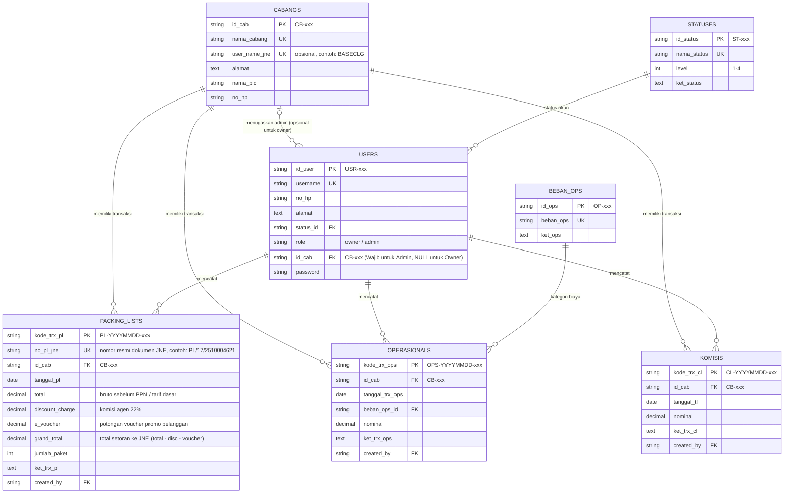

# Catatan Pengembangan Sistem Informasi Komisi & Operasional Agen JNE

Dokumen ini merangkum seluruh arsitektur data, alur bisnis, aturan hak akses, penyesuaian sistem dengan dokumen resmi Packing List JNE, rekonsiliasi transfer komisi, aturan edit/hapus transaksi (Policies), serta peningkatan fungsionalitas dan keamanan yang telah diimplementasikan di dalam sistem.

---

## 1. Arsitektur Sistem & Spesifikasi Teknologi

| Komponen | Spesifikasi / Teknologi |
| :--- | :--- |
| **Framework Backend** | Laravel 11.x (PHP 8.2+) |
| **Database Engine** | MariaDB / MySQL |
| **Timezone Aplikasi** | `Asia/Jakarta` (WIB) |
| **Frontend UI** | Blade Templating, Bootstrap 5.3, Bootstrap Icons |
| **Interaktivitas UI** | Vanilla JavaScript, Flatpickr (Datepicker ID), Custom Smart Currency & Numeric Engine |
| **Generator Dokumen** | Barryvdh Laravel DomPDF (Format Cetak Laporan Resmi A4) |
| **Keamanan & Otorisasi** | Session Auth, Role-Based Access Control (`role:owner` & `role:admin`), Laravel Policies (`PackingListPolicy`, `OperasionalPolicy`, `KomisiPolicy`), Middleware `active`, CSRF Protection |
| **Pengujian Otomatis** | PHPUnit Feature & Unit Test Suite (48 Test Cases, 292 Assertions) |

---

## 2. Struktur Data & Relasi Entitas (Database Schema)

---

## 3. Akun Pengguna Bawaan (Default Credentials)

| Role | Username | Password | Status Akun | Cabang Terikat | Akses Halaman |
| :--- | :--- | :--- | :--- | :--- | :--- |
| **Owner** | `owner_utama` | `password` | Aktif (ST-001 / L1) | *Semua Cabang* (`NULL`) | Akses Penuh (Dashboard, Master Data, Transaksi, Laporan, PDF) |
| **Admin** | `admin_operasional` | `password` | Aktif (ST-001 / L1) | `CB-001` (Cabang Tomang Raya) | Khusus Transaksi Packing List (`/transaksi/packing-list`) cabangnya |

---

## 4. Rangkuman Modul & Hak Akses (RBAC)

### A. Autentikasi & Hak Akses Sesuai Diagram
- **Role Owner (Pemilik Agen)**:
  - Memiliki akses penuh ke Dashboard, seluruh Master Data (User, Cabang, Ops, Status), Seluruh Transaksi (Packing List, Operasional, Komisi), serta 4 Laporan Finansial dan ekspor PDF resmi.
- **Role Admin (Staf Operasional)**:
  - Admin **hanya** diizinkan mengakses Transaksi Packing List (`/transaksi/packing-list`).
  - Setelah login, Admin langsung diarahkan ke halaman Transaksi Packing List.
  - Akses ke Dashboard, Master Data, Transaksi Operasional/Komisi, dan Laporan menghasilkan **HTTP 403 (Forbidden)** bagi Admin. Link ke menu-menu tersebut disembunyikan sepenuhnya dari sidebar Admin.

### B. Admin Terikat ke Satu Cabang (Branch Binding)
1. **Aturan Bisnis**: 1 Admin = 1 Cabang. Satu cabang dapat memiliki banyak Admin. Owner tidak terikat cabang (`users.id_cab` bernilai `NULL`) dan dapat mengelola seluruh cabang.
2. **Master User**:
   - Dropdown "Cabang" hanya tampil dan wajib diisi jika Role = Admin (toggle otomatis via JavaScript).
   - Jika Role = Owner, backend secara ketat memaksa `id_cab = NULL` terlepas dari nilai form request.
   - Tabel Master User menampilkan kolom "Cabang" (tanda `-` untuk Owner).
3. **Master Cabang**:
   - Cabang yang masih digunakan oleh Pengguna (Admin) atau Transaksi tidak dapat dihapus. Sistem mengembalikan pesan error jelas berbahasa Indonesia.
4. **Transaksi Packing List oleh Admin**:
   - Dropdown cabang disembunyikan; digantikan teks readonly *"Cabang: [Nama Cabang Akun]"*.
   - Backend selalu memaksa `id_cab` milik akun admin yang sedang login dan mengabaikan nilai `id_cab` dari form.
   - Tabel Packing List untuk Admin hanya menampilkan transaksi milik cabangnya sendiri.
   - Admin tanpa cabang (anomali `id_cab = NULL`) ditolak dengan HTTP 403: *"Akun Anda belum terikat ke cabang. Hubungi Owner."*.
5. **Perpindahan Cabang**:
   - Jika Owner mengubah cabang Admin di Master User, data transaksi lama tetap tercatat di cabang lama (sesuai integritas FK per transaksi), sedangkan transaksi baru otomatis menggunakan cabang baru.

### C. Aturan Status Akun (Level 1 Login Only)
1. Login hanya diizinkan untuk akun dengan status Level 1 (`status->level == 1`). Jika berstatus Level > 1 (misal: Cuti, Suspend, Non-Aktif), login ditolak dengan pesan: `"Akun Anda sedang [Nama Status]. Hubungi Owner."`
2. Middleware `active` terpasang di semua rute terproteksi. Jika status user yang sedang login diubah menjadi non-Level 1 saat sesi berjalan, sesi langsung diputus (logout otomatis) dan diarahkan kembali ke login.
3. Status Level 1 (Aktif) tidak boleh dihapus dan levelnya tidak boleh diubah.
4. Status yang masih dipakai oleh pengguna tidak boleh dihapus (pesan error ramah).
5. Proteksi Akun Owner:
   - Owner tidak dapat menghapus dirinya sendiri.
   - Owner tidak dapat mengubah status dirinya menjadi non-Level 1.
   - Owner tidak dapat mengubah role dirinya menjadi selain Owner.
   - Sistem wajib selalu memiliki minimal satu akun Owner berstatus Aktif.

---

## 5. Aturan Izin Edit & Hapus Transaksi (Laravel Policies)

Sistem menggunakan Laravel Policies (`PackingListPolicy`, `OperasionalPolicy`, `KomisiPolicy`) dengan timezone baku `Asia/Jakarta`:

| Modul Transaksi | Aksi | Hak Akses Owner | Hak Akses Admin | Pesan Error Otorisasi (403) |
| :--- | :--- | :--- | :--- | :--- |
| **Packing List** | **Edit (PUT)** | Bebas kapan saja, seluruh cabang | **Hanya hari ini** (WIB) & hanya cabangnya sendiri | *"Packing List hanya dapat diubah pada hari yang sama saat dibuat. Hubungi Owner."* |
| **Packing List** | **Hapus (DELETE)** | Diizinkan | **Ditolak total** | *"Anda tidak berwenang melakukan aksi ini."* |
| **Operasional** | **Edit / Hapus** | Diizinkan bebas kapan saja | Ditolak total (403) | *"Anda tidak berwenang melakukan aksi ini."* |
| **Komisi Bulanan** | **Edit / Hapus** | Diizinkan bebas kapan saja | Ditolak total (403) | *"Anda tidak berwenang melakukan aksi ini."* |

### Antarmuka & Modal Edit:
- Menggunakan directive `@can('update', $item)` dan `@can('delete', $item)` pada Blade view.
- Pada tabel Packing List, jika user tidak memiliki hak sama sekali atas baris tersebut (misal Admin melihat PL kemarin), kolom Aksi menampilkan badge rapi: `<i class="bi bi-lock-fill me-1"></i>Terkunci`.
- Modal Edit tersedia pada ketiga modul transaksi (`packing-list`, `operasional`, `komisi`) dengan method PUT dan proteksi token CSRF.
- Field `kode_trx` (PL, OPS, CL) dan `created_by` bersifat **immutable** (tidak dapat diubah pada proses edit).
- Admin tidak dapat memindahkan cabang transaksi lewat modal edit (backend tetap memaksa cabang akun admin).

---

## 6. Penyesuaian Dokumen JNE & Rekonsiliasi Komisi

### A. Rumus Finansial Laba Bersih
Sistem menerapkan konfigurasi fleksibel di `config/laporan.php` yang terintegrasi dengan `.env`:
- `LABA_BASIS=discount_charge` (pilihan: `discount_charge` atau `grand_total`).
- `LABA_INCLUDE_KOMISI=false` (pilihan: `true` atau `false`).

Rumus default terpusat pada `App\Services\LabaBersihService`:
$$\text{Laba Bersih} = \sum(\text{Discount Charge}) - \sum(\text{Nominal Operasional})$$
*(Jika `LABA_INCLUDE_KOMISI=true`: $+ \sum(\text{Nominal Komisi Bulanan})$)*.

### B. Rekonsiliasi Komisi Menurut Sistem & Selisih
Laporan Komisi Bulanan (tampilan web dan cetak PDF resmi) berfungsi sebagai **laporan rekonsiliasi** antara komisi pencatatan transfer bank vs komisi riil menurut sistem Packing List.
1. **Konfigurasi Lag Bulan (`config/laporan.php`)**:
   - `KOMISI_TRANSFER_LAG_BULAN=0` (dibaca dari `.env`):
     - `0`: Transfer komisi di bulan $M$ direkonsiliasi dengan Packing List di bulan $M$ yang sama.
     - `1`: Transfer komisi di bulan $M$ direkonsiliasi dengan Packing List di bulan $M-1$ (kebiasaan transfer komisi JNE bulan sebelumnya).
2. **Tabel Rekapitulasi per Bulan-Tahun**:
   Tabel rekapitulasi memiliki 4 kolom:
   - **Bulan-Tahun**: Berdasarkan bulan transfer masuk (`tanggal_tf` di komisis).
   - **Komisi menurut sistem (Rp)**: $\sum(\text{discount\_charge})$ Packing List pada bulan terkait (memperhitungkan lag dan filter cabang).
   - **Transfer masuk (Rp)**: $\sum(\text{nominal})$ dari tabel komisis pada bulan tersebut.
   - **Selisih (Rp)**: $\text{Transfer masuk} - \text{Komisi menurut sistem}$.
3. **Format Pewarnaan Selisih**:
   - **Positif (+ Rp ...)**: Warna hijau (`text-success`), transfer lebih besar dari hitungan sistem.
   - **Negatif (- Rp ...)**: Warna merah (`text-danger`), transfer lebih kecil dari hitungan sistem.
   - **Nol (Rp 0,00)**: Teks netral.
4. **Data Asimetris**:
   - Bulan dengan transfer tanpa Packing List: Komisi Sistem = 0, Selisih = Transfer masuk (hijau).
   - Bulan dengan Packing List tanpa transfer: Transfer Masuk = 0, Selisih = - Komisi Sistem (merah).
5. **Catatan Rekonsiliasi**:
   Dicantumkan pada web dan PDF:
   > *"Selisih = Transfer masuk - Komisi menurut sistem (Disc Charge Packing List). Selisih tidak ikut dihitung dalam Laba Bersih. Mohon cek ke JNE bila selisih tidak wajar."*
   *(Jika lag > 0, ditambahkan catatan: "Komisi menurut sistem dihitung dari Packing List {lag} bulan sebelumnya.")*
6. **Integritas Penamaan "CL"**:
   Penamaan field `kode_trx_cl`, `ket_trx_cl`, serta prefix `CL-` (Clearance / Commission Ledger) dipertahankan penuh demi stabilitas database dan kesinambungan kode.

---

## 7. Engine Parser Angka Cerdas (English & Indonesia)

Sistem mendukung format angka internasional maupun standar Indonesia di backend (`App\Support\NumberParser`) dan JavaScript frontend (`parseSmartNumber`):
- Format English: `436,000.00` &rarr; `436000.00`
- Format Indonesia: `436.000,00` &rarr; `436000.00`
- Paste otomatis dari dokumen PDF resmi JNE langsung membersihkan karakter non-angka dan menghitung ulang Grand Total secara otomatis.

---

## 8. Verifikasi & Pengujian Sistem

Pengujian otomatis dijalankan melalui command `php artisan test`:
- **Hasil Pengujian**: **48 Feature & Unit Test (292 assertions) - 100% PASS**.
- Matriks pengujian meliputi:
  1. Keamanan skema migrasi database tanpa kehilangan baris data lama.
  2. Validasi `id_cab` wajib untuk Admin dan dipaksa `NULL` untuk Owner di Master User.
  3. Isolasi transaksi: Admin dipaksa menyimpan ke cabangnya sendiri dan hanya melihat transaksi cabangnya.
  4. Penolakan akses 403 jika Admin belum terikat cabang.
  5. Proteksi penghapusan cabang yang digunakan oleh data pengguna atau transaksi.
  6. Rekonsiliasi Laporan Komisi pada lag = 0 dan lag = 1 beserta penanganan data asimetris.
  7. Izin edit/hapus transaksi: Owner bebas kapan saja, Admin hanya hari ini (WIB) pada cabangnya sendiri untuk edit PL, tolak hapus PL bagi Admin, dan tolak edit/hapus Operasional & Komisi bagi Admin.
  8. Ekspor 4 Laporan PDF Resmi (A4 DomPDF) dengan filter cabang.

---

## 9. Tiga Pertanyaan Konfirmasi Keputusan Masa Depan (Future Roadmap Checkpoints)

1. **Multi-Cabang untuk Admin**:
   *Apakah di masa mendatang satu akun Admin perlu diizinkan mengelola lebih dari satu cabang (multi-cabang), ataukah aturan 1 Admin = 1 Cabang tetap dipertahankan sebagai batas tanggung jawab fisik counter?*
2. **Default Lag Transfer Komisi (`KOMISI_TRANSFER_LAG_BULAN`)**:
   *Berapa nilai default `KOMISI_TRANSFER_LAG_BULAN` yang paling cocok dengan ritme operasional riil JNE di counter Anda (nilai 0 jika transfer di bulan berjalan, atau nilai 1 jika transfer komisi JNE selalu masuk pada bulan berikutnya)?*
3. **Batas Waktu Edit Transaksi Admin**:
   *Apakah jendela waktu edit Packing List oleh Admin (hari yang sama kalender WIB) sudah dirasa pas, ataukah perlu aturan jam kerja yang lebih spesifik (misalnya sebelum jam 23:59 WIB pada hari kerja, atau maksimal 12 jam setelah input pertama kali)?*
