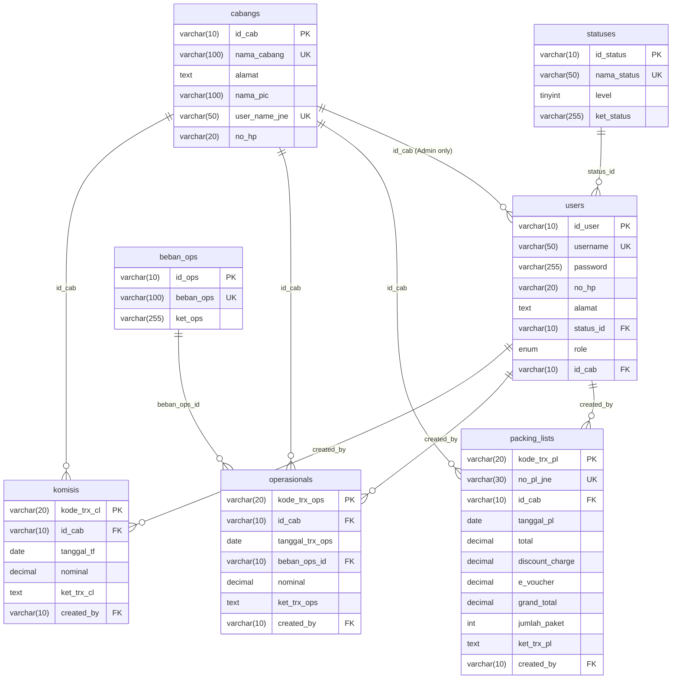
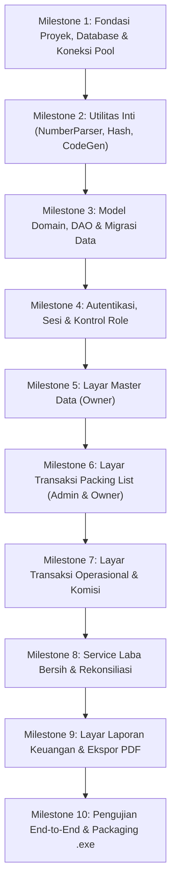

# DOKUMEN SERAH-TERIMA TEKNIS & SPESIFIKASI REBUILD SISTEM
# DARI LARAVEL 11 + MARIADB KE APLIKASI DESKTOP WINDOWS (.EXE) BERBASIS JAVA

> **Status Dokumen**: Final Hand-over Specification  
> **Target Pengembang**: AI Agent / Software Engineer Java Desktop (Standalone Windows .exe)  
> **Aplikasi Asal**: Sistem Administrasi Keuangan & Operasional Agen JNE (Laravel 11.31 + MariaDB 10.11)  
> **Bahasa Pengantar**: Bahasa Indonesia Formal  
> **Kerahasiaan**: Seluruh kredensial sensitif disensor dengan placeholder `<DB_PASSWORD>` dan *"password default, wajib diganti"*.

---

## DAFTAR ISI
1. [RINGKASAN DAN TUJUAN](#1-ringkasan-dan-tujuan)
2. [GLOSARIUM](#2-glosarium)
3. [STACK SAAT INI DAN PETA PEMINDAHAN](#3-stack-saat-ini-dan-peta-pemindahan)
4. [SKEMA DATABASE (DARI MIGRATION ASLI)](#4-skema-database-dari-migration-asli)
5. [ATURAN BISNIS LENGKAP (LOGIKA YANG WAJIB DISALIN PERSIS)](#5-aturan-bisnis-lengkap-logika-yang-wajib-disalin-persis)
   - [5a. Role dan Matriks Hak Akses](#5a-role-dan-matriks-hak-akses)
   - [5b. Lifecycle Status Akun (Level 1 s/d 4)](#5b-lifecycle-status-akun-level-1-sd-4)
   - [5c. Aturan Keterikatan Admin ke Cabang](#5c-aturan-keterikatan-admin-ke-cabang)
   - [5d. Aturan Edit dan Hapus Transaksi](#5d-aturan-edit-dan-hapus-transaksi)
   - [5e. Rumus dan Validasi Packing List](#5e-rumus-dan-validasi-packing-list)
   - [5f. Rumus Laba Bersih dan Konfigurasi](#5f-rumus-laba-bersih-dan-konfigurasi)
   - [5g. Rekonsiliasi Komisi Bulanan](#5g-rekonsiliasi-komisi-bulanan)
   - [5h. Parser Angka (NumberParser)](#5h-parser-angka-numberparser)
   - [5i. Aturan Validasi Input per Form](#5i-aturan-validasi-input-per-form)
   - [5j. Aturan Hapus Data Master (Referential Integrity)](#5j-aturan-hapus-data-master-referential-integrity)
6. [PETA FITUR PER LAYAR (UI / SCREEN SPECIFICATION)](#6-peta-fitur-per-layar-ui--screen-specification)
7. [SPESIFIKASI LAPORAN DAN PDF](#7-spesifikasi-laporan-dan-pdf)
8. [ATURAN TAMPILAN (DESIGN TOKENS)](#8-aturan-tampilan-design-tokens)
9. [ALUR PENGGUNA END-TO-END (USER SCENARIOS)](#9-alur-pengguna-end-to-end-user-scenarios)
10. [DATA SEED DAN AKUN DEFAULT](#10-data-seed-dan-akun-default)
11. [KRITERIA PENERIMAAN (ACCEPTANCE CRITERIA BERDASARKAN TEST SUITE)](#11-kriteria-penerimaan-acceptance-criteria-berdasarkan-test-suite)
12. [REKOMENDASI TEKNIS STACK JAVA (SARAN, BUKAN KEWAJIBAN)](#12-rekomendasi-teknis-stack-java-saran-bukan-kewajiban)
13. [TEMUAN DAN PERBEDAAN (CATATAN DARI PEMERIKSAAN KODE)](#13-temuan-dan-perbedaan-catatan-dari-pemeriksaan-kode)
14. [KEPUTUSAN TERBUKA (MENUNGGU PEMILIK USAHA)](#14-keputusan-terbuka-menunggu-pemilik-usaha)
15. [URUTAN PENGERJAAN YANG DISARANKAN UNTUK AGENT JAVA](#15-urutan-pengerjaan-yang-disarankan-untuk-agent-java)

---

## 1. RINGKASAN DAN TUJUAN

### 1.1 Deskripsi dan Konteks Bisnis
Aplikasi ini adalah **Sistem Administrasi Keuangan, Pencatatan Operasional, dan Rekonsiliasi Komisi Agen JNE**. Sistem ini dirancang untuk agen mitra resmi JNE yang mengoperasikan satu atau beberapa gerai (cabang). 

Secara bisnis, gerai agen menerima paket titipan dari pelanggan umum, mengumpulkan uang tunai ongkos kirim (ongkir), lalu mengelompokkan paket-paket tersebut ke dalam manifes pengiriman yang disebut **Packing List (PL)**. Fisik paket beserta cetakan Packing List kemudian diserahkan ke kantor perwakilan pusat JNE. Agen mendapatkan imbalan berupa **komisi agen** (pada dokumen resmi JNE dinamakan *Disc Charge* atau *Discount Charge*, dengan tarif umum 22% dari biaya sebelum PPN). Di samping komisi harian pada Packing List, JNE pusat mentransfer pembayaran komisi bulanan (tabel *komisis*). Pemilik agen juga mengeluarkan pengeluaran rutin operasional (sewa tempat, listrik, air, gaji, internet, ATK).

### 1.2 Profil Pengguna
Sistem memiliki dua tingkatan otorisasi pengguna (*Role*):
1. **Owner (Pemilik Usaha)**: Memiliki hak mutlak (Superadmin) atas seluruh sistem. Owner tidak terikat pada cabang tertentu (`id_cab = NULL`) dan dapat memantau seluruh cabang secara konsolidasi maupun per cabang, mengelola data master (Pengguna, Cabang, Beban Operasional, Status Akun), mengelola transaksi pengeluaran operasional dan komisi bulanan, melihat dashboard laba, serta mencetak laporan PDF.
2. **Admin (Staf Kasir/Operasional Cabang)**: Bertugas di gerai fisik dan **wajib terikat pada tepat 1 cabang** (`id_cab` tidak boleh kosong). Admin hanya memiliki hak akses tunggal ke menu transaksi Packing List cabang miliknya. Admin hanya boleh melihat daftar PL cabangnya, menginput PL baru, serta mengoreksi (edit) data PL yang diinput pada hari yang sama. Admin ditolak secara mutlak dari akses master data, biaya operasional, komisi, dashboard, dan laporan.

### 1.3 Alur Besar Aplikasi
Alur bisnis utama aplikasi berjalan dalam siklus terpadu:  
`Data Master (Cabang, Akun, Kategori Beban) -> Transaksi Harian Cabang (Input PL) & Operasional -> Rekonsiliasi Transfer Komisi Bulanan -> Perhitungan Laba Bersih & Laporan PDF`.

### 1.4 Tujuan Migrasi ke Desktop Java
Migrasi ini bertujuan memindahkan seluruh logika, aturan bisnis, integritas data referensial, formula perhitungan laba, dan estetika antarmuka dari aplikasi web Laravel 11 menjadi program desktop Windows portabel/executable tunggal (`.exe`) berbasis Java (JRE tertanam). Perilaku sistem pada versi Java harus **100% IDENTIK** dengan perilaku sistem Laravel yang telah lolos pengujian 48 test suite.

---

## 2. GLOSARIUM

Tabel berikut merangkum istilah resmi, kode singkatan, dan formula dalam sistem:

| Istilah / Kode | Nama Lengkap / Kolom DB | Definisi & Arti Bisnis |
| :--- | :--- | :--- |
| **PL** | `packing_lists` / `kode_trx_pl` | **Packing List**. Dokumen manifes harian tanda serah terima paket dari agen ke JNE. |
| **No. PL JNE** | `no_pl_jne` | Nomor registrasi resmi yang tercetak pada dokumen fisik JNE (contoh: `PL/17/2510004621`). Wajib unik, opsional hanya pada data historis lama. |
| **OPS** | `operasionals` / `kode_trx_ops` | **Biaya Operasional**. Catatan transaksi pengeluaran kas gerai untuk sewa, utilitas, gaji, dan kebutuhan operasional. |
| **CL** | `komisis` / `kode_trx_cl` | **Catatan Komisi Bulanan**. Transaksi pencatatan transfer kas komisi dari JNE Pusat ke rekening pemilik agen (secara historis disingkat dari *Commission Ledger*). |
| **Total** | `total` (DECIMAL 15,2) | **Total Penjualan Bruto**. Akumulasi tarif ongkos kirim kotor sebelum potongan apa pun yang dibayarkan pengirim paket. |
| **Disc Charge** | `discount_charge` (DECIMAL 15,2) | **Discount Charge**. Komisi hak agen yang dipotong langsung saat penyetoran manifes ke JNE (bukan diskon ke konsumen). |
| **e-Voucher** | `e-voucher` (DECIMAL 15,2) | Potongan promosi digital/voucher diskon JNE yang mengurangi nilai setoran tunai. Default `0.00`. |
| **Grand Total** | `grand_total` (DECIMAL 15,2) | **Nilai Setoran Bersih ke JNE**. Uang kas fisik yang wajib disetorkan agen ke kasir JNE Pusat. |
| **Status Level 1-4**| `statuses.level` (TINYINT) | Tingkatan izin akun pengguna: 1 = Aktif (boleh login), 2 = Non-Aktif, 3 = Cuti, 4 = Banned (Level 2-4 ditolak login dan langsung mematikan sesi). |
| **Lag Transfer** | `komisi_transfer_lag_bulan` | Konfigurasi pergeseran bulan pencairan komisi transfer terhadap bulan terjadinya Packing List (0 = bulan sama, 1 = PL bulan M dicairkan bulan M+1). |

### 2.1 Formula Hubungan Empat Variabel Packing List
Empat variabel keuangan pada Packing List memiliki relasi aritmetika mutlak:
$$\text{Grand Total} = \text{Total} - \text{Discount Charge} - \text{e-Voucher}$$

Aturan batas validasi:
$$(\text{Discount Charge} + \text{e-Voucher}) \le \text{Total}$$
Setiap nilai `Total`, `Discount Charge`, dan `e-Voucher` tidak boleh bernilai negatif ($x \ge 0$).

### 2.2 Angka Nyata Dokumen JNE Asli
Sistem dirancang mengacu pada dokumen fisik Packing List agen JNE:
- **No. Dokumen PL**: `PL/17/2510004621`
- **Total (Bruto)**: `Rp 436.000,00`
- **Disc Charge**: `Rp 94.876,35`
- **e-Voucher**: `Rp 0,00`
- **Grand Total**: `Rp 341.123,65`
- **Verifikasi Matematika**: $436.000,00 - 94.876,35 - 0,00 = 341.123,65$ (Tepat).

### 2.3 Penegasan: Analisis/Deduksi vs Fakta Terverifikasi Kode
1. **Analisis / Deduksi Bisnis**: 
   - Nilai *Disc Charge* sebesar Rp 94.876,35 dari total Rp 436.000,00 merepresentasikan komisi 22% agen dari tarif sebelum PPN 1,1% ($\frac{436.000}{1,011} \times 22\% \approx 94.876,35$).
   - *Grand Total* adalah uang setoran kas agen ke JNE pusat, sehingga bukan merupakan pendapatan bersih agen.
2. **Fakta Terverifikasi dari Kode**:
   - Backend menghitung ulang dan menimpa nilai `grand_total` yang dikirim client dengan formula $Total - Discount Charge - eVoucher$.
   - Service laba bersih (`LabaBersihService`) secara default mengonfigurasi basis laba dari `discount_charge` ($\text{Laba} = \sum \text{Disc Charge} - \sum \text{Nominal Operasional}$).

---

## 3. STACK SAAT INI DAN PETA PEMINDAHAN

### 3.1 Versi Stack Asal (Laravel)
- **PHP**: `^8.2` (PHP 8.2 CLI)
- **Framework**: `Laravel 11.57.1` (Requirement: `^11.31`)
- **Database Engine**: `MariaDB 10.11+` / `MySQL 8.0+`
- **PDF Renderer**: `barryvdh/laravel-dompdf: v3.1.2` (Dompdf core `v3.1.6`)
- **Frontend Assets**: Bootstrap 5.3, Bootstrap Icons 1.11, Flatpickr 4.6 (via CDN & CSS kustom)

### 3.2 Tabel Pemetaan Komponen ke Java Desktop

| Komponen Laravel 11 | Komponen Java Desktop Ekuivalen | Keterangan Pemindahan |
| :--- | :--- | :--- |
| **Blade Templating & CSS** | JavaFX (FXML + CSS) atau Java Swing + FlatLaf | Wajib mengadopsi Design Tokens kaku (radius 4px, navy palette). |
| **Routing & Middleware** | Router Internal / Screen Navigator Controller | Interseptor navigasi memeriksa role dan status level 1 sebelum ganti layar. |
| **Eloquent ORM** | JDBC DAO murni / jOOQ / Spring Data JDBC | Menggunakan parameterized query (`PreparedStatement`) untuk keamanan SQL. |
| **Form Request & Validator** | Validator Service Class terpusat | Validasi regex, batas numerik, dan lookup database sebelum simpan. |
| **Database Migrations** | Skrip SQL DDL / Flyway / Liquibase | Skrip inisialisasi tabel saat instalasi desktop pertama kali. |
| **Database Seeders** | Java Seed Runner / Skrip SQL `seed_data.sql` | Mengisi data status awal, cabang, beban operasional, dan akun default. |
| **Barryvdh / DomPDF** | OpenPDF / JasperReports / Apache PDFBox | Mencetak berkas PDF ukuran A4 (Landscape untuk PL, Portrait untuk lainnya). |
| **Hash::make (bcrypt)** | `jBCrypt` (`org.mindrot.jbcrypt.BCrypt`) | Wajib mendukung verifikasi password hash prefix `$2y$` dan `$2a$`. |
| **CodeGenerator** | `CodeGenerator.java` terpusat | Generator kode sequence berformat tanggal dengan locking transaksi DB. |
| **NumberParser** | `NumberParser.java` terpusat | Parsing teks angka format Indonesia dan Inggris ke `BigDecimal`. |
| **LabaBersihService** | `LabaBersihService.java` terpusat | Logika kalkulasi laba bulanan, dashboard summary, dan rekonsiliasi. |

---

## 4. SKEMA DATABASE (DARI MIGRATION ASLI)

Sistem bisnis terdiri dari 7 tabel relasional. Semua foreign key memiliki aturan `ON DELETE RESTRICT` (atau `RESTRICT` implisit) untuk menjamin integritas referensial.

### 4.1 DDL Lengkap MariaDB (100% Cocok SHOW CREATE TABLE)

```sql
-- 1. Tabel Status Pengguna
CREATE TABLE `statuses` (
  `id_status` varchar(10) NOT NULL,
  `nama_status` varchar(50) NOT NULL,
  `level` tinyint(3) unsigned NOT NULL,
  `ket_status` varchar(255) NOT NULL,
  `created_at` timestamp NULL DEFAULT NULL,
  `updated_at` timestamp NULL DEFAULT NULL,
  PRIMARY KEY (`id_status`),
  UNIQUE KEY `statuses_nama_status_unique` (`nama_status`)
) ENGINE=InnoDB DEFAULT CHARSET=utf8mb4 COLLATE=utf8mb4_unicode_ci;

-- 2. Tabel Cabang / Gerai Agen
CREATE TABLE `cabangs` (
  `id_cab` varchar(10) NOT NULL,
  `nama_cabang` varchar(100) NOT NULL,
  `alamat` text NOT NULL,
  `nama_pic` varchar(100) NOT NULL,
  `user_name_jne` varchar(50) DEFAULT NULL,
  `no_hp` varchar(20) NOT NULL,
  `created_at` timestamp NULL DEFAULT NULL,
  `updated_at` timestamp NULL DEFAULT NULL,
  PRIMARY KEY (`id_cab`),
  UNIQUE KEY `cabangs_nama_cabang_unique` (`nama_cabang`),
  UNIQUE KEY `cabangs_user_name_jne_unique` (`user_name_jne`)
) ENGINE=InnoDB DEFAULT CHARSET=utf8mb4 COLLATE=utf8mb4_unicode_ci;

-- 3. Tabel Kategori Beban Operasional
CREATE TABLE `beban_ops` (
  `id_ops` varchar(10) NOT NULL,
  `beban_ops` varchar(100) NOT NULL,
  `ket_ops` varchar(255) DEFAULT NULL,
  `created_at` timestamp NULL DEFAULT NULL,
  `updated_at` timestamp NULL DEFAULT NULL,
  PRIMARY KEY (`id_ops`),
  UNIQUE KEY `beban_ops_beban_ops_unique` (`beban_ops`)
) ENGINE=InnoDB DEFAULT CHARSET=utf8mb4 COLLATE=utf8mb4_unicode_ci;

-- 4. Tabel Pengguna (Users)
CREATE TABLE `users` (
  `id_user` varchar(10) NOT NULL,
  `username` varchar(50) NOT NULL,
  `password` varchar(255) NOT NULL,
  `no_hp` varchar(20) NOT NULL,
  `alamat` text NOT NULL,
  `status_id` varchar(10) NOT NULL,
  `role` enum('owner','admin') NOT NULL DEFAULT 'admin',
  `id_cab` varchar(10) DEFAULT NULL,
  `remember_token` varchar(100) DEFAULT NULL,
  `created_at` timestamp NULL DEFAULT NULL,
  `updated_at` timestamp NULL DEFAULT NULL,
  PRIMARY KEY (`id_user`),
  UNIQUE KEY `users_username_unique` (`username`),
  KEY `users_status_id_foreign` (`status_id`),
  KEY `users_id_cab_foreign` (`id_cab`),
  CONSTRAINT `users_id_cab_foreign` FOREIGN KEY (`id_cab`) REFERENCES `cabangs` (`id_cab`),
  CONSTRAINT `users_status_id_foreign` FOREIGN KEY (`status_id`) REFERENCES `statuses` (`id_status`)
) ENGINE=InnoDB DEFAULT CHARSET=utf8mb4 COLLATE=utf8mb4_unicode_ci;

-- 5. Tabel Transaksi Packing List
CREATE TABLE `packing_lists` (
  `kode_trx_pl` varchar(20) NOT NULL,
  `no_pl_jne` varchar(30) DEFAULT NULL,
  `id_cab` varchar(10) NOT NULL,
  `tanggal_pl` date NOT NULL,
  `total` decimal(15,2) NOT NULL,
  `discount_charge` decimal(15,2) NOT NULL DEFAULT 0.00,
  `e_voucher` decimal(15,2) NOT NULL DEFAULT 0.00,
  `grand_total` decimal(15,2) NOT NULL,
  `jumlah_paket` int(10) unsigned NOT NULL,
  `ket_trx_pl` text DEFAULT NULL,
  `created_by` varchar(10) NOT NULL,
  `created_at` timestamp NULL DEFAULT NULL,
  `updated_at` timestamp NULL DEFAULT NULL,
  PRIMARY KEY (`kode_trx_pl`),
  UNIQUE KEY `packing_lists_no_pl_jne_unique` (`no_pl_jne`),
  KEY `packing_lists_id_cab_foreign` (`id_cab`),
  KEY `packing_lists_created_by_foreign` (`created_by`),
  KEY `packing_lists_tanggal_pl_index` (`tanggal_pl`),
  CONSTRAINT `packing_lists_created_by_foreign` FOREIGN KEY (`created_by`) REFERENCES `users` (`id_user`),
  CONSTRAINT `packing_lists_id_cab_foreign` FOREIGN KEY (`id_cab`) REFERENCES `cabangs` (`id_cab`)
) ENGINE=InnoDB DEFAULT CHARSET=utf8mb4 COLLATE=utf8mb4_unicode_ci;

-- 6. Tabel Transaksi Operasional
CREATE TABLE `operasionals` (
  `kode_trx_ops` varchar(20) NOT NULL,
  `id_cab` varchar(10) NOT NULL,
  `tanggal_trx_ops` date NOT NULL,
  `beban_ops_id` varchar(10) NOT NULL,
  `nominal` decimal(15,2) NOT NULL,
  `ket_trx_ops` text DEFAULT NULL,
  `created_by` varchar(10) NOT NULL,
  `created_at` timestamp NULL DEFAULT NULL,
  `updated_at` timestamp NULL DEFAULT NULL,
  PRIMARY KEY (`kode_trx_ops`),
  KEY `operasionals_id_cab_foreign` (`id_cab`),
  KEY `operasionals_beban_ops_id_foreign` (`beban_ops_id`),
  KEY `operasionals_created_by_foreign` (`created_by`),
  KEY `operasionals_tanggal_trx_ops_index` (`tanggal_trx_ops`),
  CONSTRAINT `operasionals_beban_ops_id_foreign` FOREIGN KEY (`beban_ops_id`) REFERENCES `beban_ops` (`id_ops`),
  CONSTRAINT `operasionals_created_by_foreign` FOREIGN KEY (`created_by`) REFERENCES `users` (`id_user`),
  CONSTRAINT `operasionals_id_cab_foreign` FOREIGN KEY (`id_cab`) REFERENCES `cabangs` (`id_cab`)
) ENGINE=InnoDB DEFAULT CHARSET=utf8mb4 COLLATE=utf8mb4_unicode_ci;

-- 7. Tabel Transaksi Komisi Bulanan
CREATE TABLE `komisis` (
  `kode_trx_cl` varchar(20) NOT NULL,
  `id_cab` varchar(10) NOT NULL,
  `tanggal_tf` date NOT NULL,
  `nominal` decimal(15,2) NOT NULL,
  `ket_trx_cl` text DEFAULT NULL,
  `created_by` varchar(10) NOT NULL,
  `created_at` timestamp NULL DEFAULT NULL,
  `updated_at` timestamp NULL DEFAULT NULL,
  PRIMARY KEY (`kode_trx_cl`),
  KEY `komisis_id_cab_foreign` (`id_cab`),
  KEY `komisis_created_by_foreign` (`created_by`),
  KEY `komisis_tanggal_tf_index` (`tanggal_tf`),
  CONSTRAINT `komisis_created_by_foreign` FOREIGN KEY (`created_by`) REFERENCES `users` (`id_user`),
  CONSTRAINT `komisis_id_cab_foreign` FOREIGN KEY (`id_cab`) REFERENCES `cabangs` (`id_cab`)
) ENGINE=InnoDB DEFAULT CHARSET=utf8mb4 COLLATE=utf8mb4_unicode_ci;
```

### 4.2 Diagram Relasi Entitas (ERD)



### 4.3 Logika Generator Kode Unik (CodeGenerator)
Seluruh primary key pada sistem di-generate manual dengan prefix dan sequence 3 digit (contoh: `001`, `002`).

1. **Master Data (Static Prefix)**:
   - `statuses`: Prefix `ST-` $\rightarrow$ `ST-001`, `ST-002`, ...
   - `cabangs`: Prefix `CB-` $\rightarrow$ `CB-001`, `CB-002`, ...
   - `beban_ops`: Prefix `OP-` $\rightarrow$ `OP-001`, `OP-002`, ...
   - `users`: Prefix `USR-` $\rightarrow$ `USR-001`, `USR-002`, ...
   *Algoritma*: Mengambil record terakhir berdasarkan ID descending, mengekstrak angka sequence terakhir dengan regex `/\d+$/`, menambahkan 1, dan melakukan formatting `%03d`.

2. **Data Transaksi (Date-based Prefix)**:
   - `packing_lists`: `PL-YYYYMMDD-xxx` (contoh: `PL-20261105-001`) berdasarkan `tanggal_pl`.
   - `operasionals`: `OPS-YYYYMMDD-xxx` (contoh: `OPS-20261105-001`) berdasarkan `tanggal_trx_ops`.
   - `komisis`: `CL-YYYYMMDD-xxx` (contoh: `CL-20261105-001`) berdasarkan `tanggal_tf`.
   *Algoritma*: Mencari nomor kode transaksi terbesar dengan prefix `PL-YYYYMMDD-` pada tanggal tersebut. Sequence dihitung per hari dimulai dari `001`.

3. **Penanganan Race Condition di Java**:
   Pada implementasi Java, query pencarian sequence wajib dibungkus dalam transaksi database dengan klausa pesimistik:
   ```sql
   SELECT kode_trx_pl FROM packing_lists 
   WHERE kode_trx_pl LIKE 'PL-20261105-%' 
   ORDER BY kode_trx_pl DESC LIMIT 1 FOR UPDATE;
   ```

### 4.4 Tabel Framework yang Dikecualikan
Tabel-tabel internal Laravel berikut **TIDAK PERLU** dibuat di aplikasi desktop Java:
- `migrations`
- `sessions` / `cache` / `cache_locks`
- `jobs` / `job_batches` / `failed_jobs`
- `password_reset_tokens`

### 4.5 Kompatibilitas Hash Password (Bcrypt)
Laravel menggunakan format standar bcrypt:
`$2y$[cost]$[22 karakter salt][31 karakter hash]` (total 60 karakter).
- Library Java seperti `org.mindrot.jbcrypt.BCrypt` secara bawaan mendukung prefix `$2a$`.
- Untuk membaca dan memvalidasi password lama dari database Laravel, Java harus mengganti 4 karakter pertama string hash dari `$2y$` menjadi `$2a$` sebelum memanggil `BCrypt.checkpw(inputPassword, storedHash.replaceFirst("^\\$2y\\$", "\\$2a\\$"))`.

---

## 5. ATURAN BISNIS LENGKAP (LOGIKA YANG WAJIB DISALIN PERSIS)

### 5a. Role dan Matriks Hak Akses
Sistem membedakan izin akses secara mutlak antara Owner dan Admin.

| Fitur / Layar / Menu | Owner | Admin |
| :--- | :---: | :---: |
| **Akses Dashboard Ringkasan** | Ya | Ditolak (403) |
| **Master Pengguna (CRUD)** | Ya | Ditolak (403) |
| **Master Cabang (CRUD)** | Ya | Ditolak (403) |
| **Master Beban Operasional (CRUD)** | Ya | Ditolak (403) |
| **Master Status Akun (CRUD)** | Ya | Ditolak (403) |
| **Transaksi Packing List - View / List** | Ya (Semua Cabang) | Ya (Hanya Cabang Sendiri) |
| **Transaksi Packing List - Create** | Ya (Bebas Cabang) | Ya (Otomatis Cabang Sendiri) |
| **Transaksi Packing List - Edit** | Ya (Kapan Saja) | Terbatas (Hari Ini Saja, Cabang Sendiri) |
| **Transaksi Packing List - Delete** | Ya (Kapan Saja) | Ditolak (403) |
| **Transaksi Biaya Operasional (CRUD)** | Ya | Ditolak (403) |
| **Transaksi Komisi Bulanan (CRUD)** | Ya | Ditolak (403) |
| **Semua Laporan & Export PDF** | Ya | Ditolak (403) |

- **Redirect Awal Saat Login**:
  - Bila pengguna ber-role `admin` berhasil login: langsung diarahkan ke layar **Transaksi Packing List** (`/transaksi/packing-list`).
  - Bila pengguna ber-role `owner` berhasil login: diarahkan ke layar **Dashboard** (`/dashboard`).
  - Request ke root `/` otomatis mengikuti aturan redirect role di atas.

### 5b. Lifecycle Status Akun (Level 1 s/d 4)
Tabel status akun (`statuses`) memiliki kolom level numerik:
- **Level 1 (Aktif)**: Akun aktif dan diizinkan login.
- **Level 2 (Non-Aktif)**: Akun dinonaktifkan sementara.
- **Level 3 (Cuti)**: Staf sedang cuti kerja.
- **Level 4 (Banned)**: Akun diblokir permanen.

#### Aturan Login Gate & Session Termination
1. Pengguna hanya dapat login jika `users.status.level == 1`. Bila level bukan 1, login ditolak dengan pesan:
   `"Akun Anda sedang [Nama Status]. Hubungi Owner."`
2. Bila saat pengguna sedang membuka aplikasi lalu statusnya diubah menjadi selain level 1 oleh Owner, interseptor sesi (*active middleware*) wajib langsung mematikan sesi, mengeluarkan pengguna, dan menampilkan pesan:
   `"Sesi Anda berakhir karena status akun Anda saat ini sedang [Nama Status]. Hubungi Owner."`

#### Aturan Perlindungan Owner (Invariants)
1. **Perlindungan Diri Sendiri**: Owner yang sedang login **tidak boleh** mengubah role akunnya sendiri, **tidak boleh** menonaktifkan status akunnya sendiri (level $\ne$ 1), dan **tidak boleh** menghapus akunnya sendiri.
   - Pesan gagal ganti role: `"Anda tidak dapat mengubah role akun Anda sendiri."`
   - Pesan gagal non-aktifkan diri: `"Owner tidak dapat mengubah status dirinya menjadi non-Aktif ([Nama Status])."`
   - Pesan gagal hapus diri: `"Anda tidak dapat menghapus akun Anda sendiri yang sedang aktif digunakan."`
2. **Ketersediaan Owner Minimal**: Database **wajib selalu memiliki minimal satu akun Owner dengan status Aktif (Level 1)**. Aksi pengubahan status, role, atau penghapusan yang menyebabkan jumlah Owner aktif menjadi 0 ditolak dengan pesan:
   `"Sistem harus memiliki minimal satu Owner berstatus Aktif."` (untuk update) atau `"Tidak dapat menghapus user ini karena sistem harus memiliki minimal satu Owner berstatus Aktif."` (untuk delete).
3. **Perlindungan Status Level 1**:
   - Status dengan `level == 1` atau `id_status == 'ST-001'` **tidak boleh dihapus** (`"Status Level 1 (Aktif) tidak boleh dihapus."`).
   - Nilai level dari status yang sedang ber-level 1 **tidak boleh diubah** ke level lain (`"Level status untuk status Level 1 (Aktif) tidak boleh diubah."`).

### 5c. Aturan Keterikatan Admin ke Cabang
1. Setiap akun dengan role `admin` **wajib terikat pada tepat 1 cabang** (`users.id_cab` NOT NULL). Pada form User, field Cabang wajib dipilih untuk Admin.
2. Setiap akun dengan role `owner` **dipaksa bernilai NULL** untuk `users.id_cab` (Owner berada di atas seluruh cabang).
3. Jika terdapat akun Admin tanpa cabang mencoba membuka transaksi Packing List, akses diblokir (HTTP 403):
   `"Akun Anda belum terikat ke cabang. Hubungi Owner."`
4. Pada form tambah dan edit Packing List oleh Admin:
   - Dropdown cabang disembunyikan (*hidden*) atau dinonaktifkan (*disabled*) dan otomatis terisi dengan cabang milik Admin.
   - Di sisi backend/controller, input cabang dari UI diabaikan secara mutlak; backend selalu memaksa nilai `id_cab = currentUser.id_cab`.

### 5d. Aturan Edit dan Hapus Transaksi
1. **Matriks Otorisasi Modifikasi Transaksi**:
   - Transaksi Packing List:
     - Owner: Boleh edit dan hapus kapan saja tanpa batas waktu.
     - Admin: Hanya boleh mengedit Packing List yang cabang-nya sama dengan cabangnya **DAN** tanggal pembuatan (`created_at`) adalah **hari ini** pada timezone `Asia/Jakarta`.
     - Admin: Ditolak mutlak menghapus Packing List kapan pun.
   - Transaksi Operasional & Komisi Bulanan:
     - Owner: Boleh edit dan hapus kapan saja.
     - Admin: Ditolak mutlak (403) melakukan aksi apa pun.
2. **Pesan Penolakan Eksplisit**:
   - Admin mencoba mengedit PL hari kemarin:
     `"Packing List hanya dapat diubah pada hari yang sama saat dibuat. Hubungi Owner."`
   - Admin mencoba mengedit PL milik cabang lain atau mencoba menghapus PL:
     `"Anda tidak berwenang melakukan aksi ini."` (HTTP 403).
   - Admin mencoba mengakses URL / API Operasional atau Komisi:
     `"Akses ditolak: Anda tidak memiliki izin untuk mengakses fitur ini."` (HTTP 403).

### 5e. Rumus dan Validasi Packing List
1. **Kalkulasi Backend**:
   $$\text{Grand Total} = \text{Total} - \text{Discount Charge} - \text{e-Voucher}$$
   Input nilai `grand_total` dari sisi client selalu dihitung ulang di backend untuk mencegah manipulasi.
2. **Validasi Ambang Diskon**:
   $$\text{Discount Charge} + \text{e-Voucher} \le \text{Total}$$
   Jika nilai total diskon melebihi nilai total bruto, validasi menolak dengan pesan:
   `"Jumlah Discount Charge dan e-Voucher tidak boleh lebih besar dari total penjualan."`
3. **Validasi Positif**:
   `Total`, `Discount Charge`, dan `e-Voucher` tidak boleh bernilai negatif ($< 0$).
4. **Validasi Nomor Dokumen JNE (`no_pl_jne`)**:
   - Format: String teks alfanumerik maksimal 30 karakter (contoh: `PL/17/2510004621`). Otomatis di-uppercase dan di-trim.
   - Pada input transaksi baru: **Wajib diisi (`required`)** dan **Wajib unik (`unique`)** di seluruh tabel `packing_lists`. Pesan duplikat: `"Nomor PL JNE sudah pernah diinput."`
   - Pada pembaruan transaksi lama yang nomornya kosong (data warisan migrasi): nomor boleh tetap `NULL` (`nullable`).

### 5f. Rumus Laba Bersih dan Konfigurasi
Sistem sentralisasi perhitungan laba bersih berada di `LabaBersihService`. Konfigurasi sistem dibaca dari file konfigurasi (`config/laporan.php`):
- `laba_basis`: `'discount_charge'` (default) atau `'grand_total'`.
- `laba_include_komisi_bulanan`: `false` (default) atau `true`.

#### Formula Default:
$$\text{Laba Bersih} = \sum (\text{Discount Charge PL}) - \sum (\text{Nominal Operasional})$$
*Catatan*: Bila `laba_basis = 'grand_total'`, maka menggunakan $\sum (\text{Grand Total PL})$. Bila `laba_include_komisi_bulanan = true`, maka ditambah $+ \sum (\text{Nominal Komisi Bulanan})$.

#### Pseudocode Lengkap Algoritma Laba Bersih:
```java
public class LabaBersihService {
    public MonthlyRecapResult calculateMonthly(LocalDate startDate, LocalDate endDate, String idCab, String basis, boolean includeKomisi) {
        // 1. Agregasi Packing List per Bulan (YYYY-MM)
        Map<String, PLSummary> plMonthly = queryPlAggregated(startDate, endDate, idCab);
        // 2. Agregasi Beban Operasional per Bulan (YYYY-MM)
        Map<String, BigDecimal> opsMonthly = queryOpsAggregated(startDate, endDate, idCab);
        // 3. Agregasi Komisi Bulanan jika includeKomisi == true
        Map<String, BigDecimal> komisiMonthly = includeKomisi ? queryKomisiAggregated(startDate, endDate, idCab) : Collections.emptyMap();

        // 4. Himpun seluruh bulan unik (Outer Join union bulan)
        Set<String> allYearMonths = new TreeSet<>();
        allYearMonths.addAll(plMonthly.keySet());
        allYearMonths.addAll(opsMonthly.keySet());
        allYearMonths.addAll(komisiMonthly.keySet());

        List<MonthlyRecapRow> rows = new ArrayList<>();
        BigDecimal sumPlRevenue = BigDecimal.ZERO;
        BigDecimal sumOps = BigDecimal.ZERO;
        BigDecimal sumKomisi = BigDecimal.ZERO;
        BigDecimal sumLaba = BigDecimal.ZERO;

        for (String ym : allYearMonths) {
            PLSummary pl = plMonthly.getOrDefault(ym, PLSummary.ZERO);
            BigDecimal ops = opsMonthly.getOrDefault(ym, BigDecimal.ZERO);
            BigDecimal komisi = komisiMonthly.getOrDefault(ym, BigDecimal.ZERO);

            BigDecimal plRevenue = "grand_total".equalsIgnoreCase(basis) ? pl.getGrandTotal() : pl.getDiscountCharge();
            BigDecimal labaBersih = plRevenue.subtract(ops);
            if (includeKomisi) {
                labaBersih = labaBersih.add(komisi);
            }

            String status = labaBersih.compareTo(BigDecimal.ZERO) >= 0 ? "Surplus" : "Defisit";

            rows.add(new MonthlyRecapRow(ym, plRevenue, pl.getDiscountCharge(), pl.getGrandTotal(), ops, komisi, labaBersih, status));

            sumPlRevenue = sumPlRevenue.add(plRevenue);
            sumOps = sumOps.add(ops);
            sumKomisi = sumKomisi.add(komisi);
            sumLaba = sumLaba.add(labaBersih);
        }

        return new MonthlyRecapResult(rows, sumPlRevenue, sumOps, sumKomisi, sumLaba);
    }
}
```

### 5g. Rekonsiliasi Komisi Bulanan
Laporan Komisi Bulanan berfungsi merekonsiliasi antara **komisi hak agen menurut perhitungan sistem** dengan **uang transfer komisi riil yang masuk dari JNE**.

1. **Komisi Menurut Sistem**: $\sum (\text{Discount Charge})$ dari transaksi Packing List pada periode terkait.
2. **Transfer Masuk**: $\sum (\text{Nominal})$ dari transaksi tabel `komisis` pada periode transfer.
3. **Rumus Selisih**:
   $$\text{Selisih} = \text{Transfer Masuk} - \text{Komisi Menurut Sistem}$$
   - Nilai $0,00$: Cocok (Reconciled).
   - Nilai Positif ($> 0$): Transfer JNE lebih besar dari hitungan sistem gerai.
   - Nilai Negatif ($< 0$): Transfer JNE kurang dari hitungan sistem gerai (potensi klaim ke JNE).
4. **Penanganan Lag Transfer (`komisi_transfer_lag_bulan`)**:
   - **Skenario Lag = 0**: Transfer bulan Maret 2026 disandingkan langsung dengan Packing List bulan Maret 2026.
   - **Skenario Lag = 1**: Komisi atas pengiriman paket bulan Februari 2026 baru ditransfer JNE pada bulan Maret 2026. Maka saat filter laporan ditarik untuk tanggal transfer Maret 2026, sistem secara otomatis menarik data Packing List dari bulan Februari 2026 ($M - 1$).
5. **Independensi Selisih**: Nilai *Selisih* komisi **TIDAK PERNAH** dimasukkan ke dalam perhitungan Laba Bersih. Selisih murni bersifat rekonsiliasi audit internal.

### 5h. Parser Angka (NumberParser)
Pengguna dapat memasukkan angka dalam gaya penulisan Indonesia (`1.234.567,89`), gaya Inggris (`1,234,567.89`), angka polos (`1234567.89`), dengan atau tanpa prefix mata uang (`Rp`, `rp`, `RP`).

#### Algoritma Parsing:
1. Bersihkan string: buang prefix `(?i)^rp\.?\s*`, buang spasi, buang karakter tak terlihat.
2. Deteksi separator:
   - Jika terdapat titik DAN koma:
     - Bila posisi titik sebelum koma (contoh: `1.250,50`) $\rightarrow$ Format Indonesia: hapus titik, ubah koma jadi titik.
     - Bila posisi koma sebelum titik (contoh: `1,250.50`) $\rightarrow$ Format Inggris: hapus koma.
   - Jika hanya terdapat satu jenis pemisah:
     - Jika pemisah koma:
       - Bila diikuti tepat 1 atau 2 digit di akhir (contoh: `100,5` atau `100,50`) $\rightarrow$ Koma dianggap desimal (ubah jadi titik).
       - Bila diikuti 3 digit (contoh: `1,000` atau `2,500,000`) $\rightarrow$ Koma dianggap ribuan Inggris (hapus koma).
     - Jika pemisah titik:
       - Bila terdapat lebih dari satu titik (contoh: `1.000.000`) $\rightarrow$ Titik ribuan Indonesia (hapus semua titik).
       - Bila hanya ada satu titik:
         - Bila diikuti tepat 3 digit (contoh: `1.000` atau `50.000`) $\rightarrow$ Titik ribuan Indonesia (hapus titik).
         - Bila diikuti 1 atau 2 digit (contoh: `100.5` atau `100.50`) $\rightarrow$ Titik desimal Inggris (pertahankan titik).
3. Validasi akhir regex `^-?\d+(\.\d+)?$`. Bila gagal, lempar `InvalidArgumentException`. Simpan ke `BigDecimal` presisi 15 digit dengan 2 desimal.

#### Matriks Kasus Uji NumberParser (Berdasarkan Unit Test):

| No | Nilai Input Input String | Hasil Parsing (`double` / `BigDecimal`) | Kategori Format |
| :---: | :--- | :--- | :--- |
| 1 | `123456` | `123456.00` | Integer Polos |
| 2 | `123456.78` | `123456.78` | Desimal Polos |
| 3 | `1.234.567` | `1234567.00` | Ribuan Indonesia |
| 4 | `1.234.567,89` | `1234567.89` | Desimal Indonesia |
| 5 | `1,234,567` | `1234567.00` | Ribuan Inggris |
| 6 | `1,234,567.89` | `1234567.89` | Desimal Inggris |
| 7 | `Rp 1.234.567,89` | `1234567.89` | Prefix `Rp ` Indonesia |
| 8 | `rp. 1,234,567.89`| `1234567.89` | Prefix `rp. ` Inggris |
| 9 | ` 50.000 ` | `50000.00` | Ribuan Indonesia ber-spasi |
| 10 | `0` | `0.00` | Angka Nol |
| 11 | `0,5` | `0.50` | Desimal 1 Digit Indonesia |
| 12 | `0.75` | `0.75` | Desimal 2 Digit Inggris |
| 13 | `436,000.00` | `436000.00` | Format Nyata PL JNE |
| - | **Kasus Ditolak (Exception)** | **Alasan Penolakan** | - |
| 14 | `abc` | Teks bukan angka | Invalid |
| 15 | `12a34` | Karakter alfanumerik campuran | Invalid |
| 16 | `1.2.3.4` | Separator bertingkat tidak valid | Invalid |
| 17 | `1,2,3,4` | Separator bertingkat tidak valid | Invalid |
| 18 | `1.000,000,000` | Campuran pemisah tidak logis | Invalid |
| 19 | `1,000.000.000` | Campuran pemisah tidak logis | Invalid |
| 20 | `--100` | Double minus | Invalid |
| 21 | `100..50` | Double period | Invalid |
| 22 | `""` (String Kosong) | Input kosong | Invalid |
| 23 | `null` | Objek null | Invalid |

### 5i. Aturan Validasi Input per Form

Tabel berikut memuat aturan dan pesan error dalam bahasa Indonesia yang persis dihasilkan oleh backend:

| Nama Form | Field Input | Aturan Validasi | Pesan Error Spesifik |
| :--- | :--- | :--- | :--- |
| **Cabang** | `nama_cabang` | `required|string|max:100|unique` | `"Nama cabang wajib diisi."` / `"Nama cabang sudah terdaftar di sistem."` |
| | `alamat` | `required|string` | `"Alamat cabang wajib diisi."` |
| | `nama_pic` | `required|string|max:100` | `"Nama penanggung jawab (PIC) wajib diisi."` |
| | `user_name_jne`| `nullable|string|max:50|unique` | `"User Name JNE sudah pernah digunakan oleh cabang lain."` |
| | `no_hp` | `required|regex:/^[0-9]+$/|min:8|max:15` | `"Nomor HP cabang wajib diisi."` / `"Nomor HP hanya boleh berisi angka."` / `"Nomor HP minimal 8 digit angka."` / `"Nomor HP maksimal 15 digit angka."` |
| **Pengguna** | `nama_user` | `required|string|max:50|unique:users,username` | `"Nama pengguna wajib diisi."` / `"Nama pengguna / username sudah digunakan di sistem."` |
| | `no_hp` | `required|regex:/^[0-9]+$/|min:8|max:15` | `"Nomor HP wajib diisi."` / `"Nomor HP hanya boleh berisi angka."` / `"Nomor HP minimal 8 digit angka."` / `"Nomor HP maksimal 15 digit angka."` |
| | `alamat` | `required|string` | `"Alamat lengkap wajib diisi."` |
| | `status` | `required|string` | `"Status akun wajib dipilih."` |
| | `id_cab` | `required_if:role,admin|exists:cabangs,id_cab` | `"Cabang penugasan wajib dipilih untuk Admin."` / `"Cabang yang dipilih tidak terdaftar di sistem."` |
| | `password` | Create: `required|min:6`<br>Update: `nullable|min:6` | `"Password wajib diisi."` / `"Password minimal 6 karakter."` |
| **Beban Ops**| `beban_ops` | `required|string|max:100|unique` | `"Nama beban operasional wajib diisi."` / `"Nama beban operasional sudah terdaftar."` / `"Nama beban operasional maksimal 100 karakter."` |
| | `ket_ops` | `required|string|max:255` | `"Keterangan operasional wajib diisi."` / `"Keterangan operasional maksimal 255 karakter."` |
| **Status** | `nama_status` | `required|string|max:50|unique` | `"Nama status wajib diisi."` / `"Nama status sudah terdaftar di sistem."` |
| | `level` | `required|integer|in:1,2,3,4` | `"Level status wajib dipilih."` / `"Level status harus antara 1 sampai 4."` |
| | `ket_status` | `required|string|max:255` | `"Keterangan status wajib diisi."` |
| **Packing List** | `no_pl_jne` | New: `required|string|max:30|unique`<br>Edit: `nullable|string|max:30|unique_ignore` | `"Nomor PL JNE wajib diisi."` / `"Nomor PL JNE sudah pernah diinput."` |
| | `id_cab` | `required|exists:cabangs,id_cab` | `"Cabang wajib dipilih."` / `"Cabang yang dipilih tidak valid di sistem."` |
| | `tanggal_pl` | `required` (Format `d-m-Y` atau `Y-m-d`) | `"Tanggal packing list wajib diisi."` |
| | `jumlah_paket` | `required|integer|min:0` | `"Jumlah paket wajib diisi."` / `"Jumlah paket harus berupa bilangan bulat."` / `"Jumlah paket tidak boleh negatif."` |
| | `total` | `required` (NumberParser $\ge 0$) | `"Total penjualan wajib diisi."` / `"Format angka tidak dikenali pada Total penjualan."` / `"Total penjualan tidak boleh bernilai negatif."` |
| | `discount_charge` | `required` (NumberParser $\ge 0$) | `"Discount charge wajib diisi."` / `"Format angka tidak dikenali pada Discount charge."` / `"Discount charge tidak boleh bernilai negatif."` |
| | `e_voucher` | `nullable` (NumberParser $\ge 0$) | `"Format angka tidak dikenali pada e-Voucher."` / `"e-Voucher tidak boleh bernilai negatif."` |
| | Relasi Diskon | $(\text{Disc} + \text{eVoucher}) \le \text{Total}$ | `"Jumlah Discount Charge dan e-Voucher tidak boleh lebih besar dari total penjualan."` |
| | `ket_trx_pl` | `required|string` | `"Keterangan transaksi wajib diisi."` |
| **Operasional** | `id_cab` | `required|exists:cabangs,id_cab` | `"Cabang wajib dipilih."` / `"Cabang yang dipilih tidak valid di sistem."` |
| | `tanggal_trx_ops`| `required` | `"Tanggal transaksi operasional wajib diisi."` |
| | `beban_ops` | `required_without:beban_ops_id` | `"Beban Operasional wajib dipilih."` |
| | `nominal` | `required` (NumberParser $> 0$) | `"Nominal biaya wajib diisi."` |
| | `ket_trx_ops` | `required|string` | `"Keterangan pengeluaran operasional wajib diisi."` |
| **Komisi** | `id_cab` | `required|exists:cabangs,id_cab` | `"Cabang wajib dipilih."` / `"Cabang yang dipilih tidak valid di sistem."` |
| | `tanggal_tf` | `required` | `"Tanggal transfer komisi wajib diisi."` |
| | `nominal` | `required` (NumberParser $> 0$) | `"Nominal transfer komisi wajib diisi."` |
| | `ket_trx_cl` | `required|string` | `"Keterangan transaksi komisi wajib diisi."` |

### 5j. Aturan Hapus Data Master (Referential Integrity)

1. **Penghapusan Cabang (`cabangs`)**:
   - Ditolak jika cabang masih memiliki akun Pengguna yang terikat:  
     `"Cabang [Nama Cabang] ([ID]) tidak dapat dihapus karena masih digunakan oleh data pengguna (Admin)."`
   - Ditolak jika cabang telah memiliki transaksi di `packing_lists`, `operasionals`, atau `komisis`:  
     `"Cabang [Nama Cabang] ([ID]) tidak dapat dihapus karena masih digunakan dalam data transaksi."`
2. **Penghapusan Beban Operasional (`beban_ops`)**:
   - Ditolak jika kategori beban sudah digunakan pada riwayat transaksi pengeluaran operasional:  
     `"Kategori operasional [Nama Beban] ([ID]) tidak dapat dihapus karena masih digunakan pada data transaksi operasional."`
3. **Penghapusan Status Akun (`statuses`)**:
   - Ditolak jika status ber-level 1 atau memiliki ID `ST-001`:  
     `"Status Level 1 (Aktif) tidak boleh dihapus."`
   - Ditolak jika status sedang terpasang pada satu atau lebih akun pengguna:  
     `"Status [Nama Status] ([ID]) tidak dapat dihapus karena masih digunakan pada data pengguna (User)."`
4. **Penghapusan Pengguna (`users`)**:
   - Ditolak jika user mencoba menghapus dirinya sendiri:  
     `"Anda tidak dapat menghapus akun Anda sendiri yang sedang aktif digunakan."`
   - Ditolak jika user adalah Owner dan merupakan satu-satunya Owner berstatus Aktif di sistem:  
     `"Tidak dapat menghapus user ini karena sistem harus memiliki minimal satu Owner berstatus Aktif."`
   - Ditolak jika user tercatat sebagai pembuat transaksi (`created_by`):  
     `"Tidak dapat menghapus user ini karena terdapat transaksi yang terkait dengannya."`

---

## 6. PETA FITUR PER LAYAR (UI / SCREEN SPECIFICATION)

Setiap layar harus dibangun dengan tata letak flat dan padat informasi:

```
+---------------------------------------------------------------------------------------+
|  TOPBAR: Judul Halaman Aktif | [Nama Cabang Terpilih]        [User Badge] [Tombol Logout]
+---------------------------------------------------------------------------------------+
| SIDEBAR               | MAIN CONTENT AREA                                             |
| [LOGO] Sistem Agen    | +-----------------------------------------------------------+ |
| --------------------- | | FILTER BAR: Tanggal Mulai | Tanggal Akhir | Cabang | Filter| |
| DASHBOARD (Owner)     | +-----------------------------------------------------------+ |
| MASTER DATA (Owner)   |                                                               |
|  - Pengguna           | [Tabel Data Utama / Kartu Rekapitulasi]                       |
|  - Cabang             |                                                               |
|  - Beban Operasional  |                                                               |
|  - Status Akun        |                                                               |
| TRANSAKSI             |                                                               |
|  - Packing List       |                                                               |
|  - Biaya Operasional  |                                                               |
|  - Komisi Bulanan     |                                                               |
| LAPORAN (Owner)       |                                                               |
|  - Laba Bersih        |                                                               |
|  - Packing List       |                                                               |
|  - Operasional        |                                                               |
|  - Komisi Bulanan     |                                                               |
+---------------------------------------------------------------------------------------+
```

### 6.1 Layar Login (`/login`)
- **Elemen**: Kotak login di tengah layar, input Username, input Password, tombol Masuk.
- **Perilaku**: Menolak akun non-aktif, melakukan otentikasi bcrypt, mengarahkan Owner ke Dashboard dan Admin ke Packing List.

### 6.2 Layar Dashboard (`/dashboard` - Khusus Owner)
- **Komponen**:
  1. Filter Cabang (`Semua Cabang` atau cabang spesifik).
  2. Empat Kartu Ringkasan Keuangan:
     - **Kartu Laba Bersih**: Nilai laba bersih (hijau jika $\ge 0$, merah jika defisit), label basis perhitungan saat ini.
     - **Kartu Pendapatan Komisi PL**: Nilai total `discount_charge` dari seluruh PL.
     - **Kartu Total Operasional**: Nilai total pengeluaran operasional.
     - **Kartu Komisi Bulanan**: Nilai total transfer komisi masuk.
  3. Kartu Statistik Operasional: Total Paket Terkirim, Total Transaksi PL, Total Transaksi Biaya.
  4. Tabel Ringkasan Cabang: Menampilkan performa komisi, operasional, dan laba bersih tiap gerai.

### 6.3 Layar Master Pengguna (`/master/user` - Khusus Owner)
- **Tabel**: ID User, Username, Role (Badge), Cabang Penugasan, No. HP, Alamat, Status (Badge), Tombol Aksi (Edit, Hapus).
- **Form Modal Tambah / Edit**:
  - Username (Teks)
  - Role (Dropdown: `Owner`, `Admin`)
  - Cabang Penugasan (Dropdown dari `cabangs`, wajib jika Admin, otomatis dinonaktifkan jika Owner)
  - No. HP (Teks angka)
  - Alamat (Textarea)
  - Status Akun (Dropdown dari `statuses`)
  - Password (Input teks/password; kosongkan saat edit jika tidak ingin mengganti)

### 6.4 Layar Master Cabang (`/master/cabang` - Khusus Owner)
- **Tabel**: ID Cabang, Nama Cabang, Alamat, Nama PIC, User Name JNE, No. HP, Tombol Aksi (Edit, Hapus).
- **Form Modal**: Seluruh field teks sesuai tabel.

### 6.5 Layar Master Beban Operasional (`/master/ops` - Khusus Owner)
- **Tabel**: ID Ops, Nama Kategori Beban Operasional, Keterangan, Tombol Aksi (Edit, Hapus).

### 6.6 Layar Master Status Akun (`/master/status` - Khusus Owner)
- **Tabel**: ID Status, Nama Status, Level (1 s/d 4), Keterangan, Tombol Aksi (Edit, Hapus).
- **Proteksi UI**: Tombol Hapus dinonaktifkan untuk status level 1 (`ST-001`).

### 6.7 Layar Transaksi Packing List (`/transaksi/packing-list`)
- **Tabel**: Kode Trx (`PL-xxx`), No. PL JNE, Cabang, Tanggal, Total Bruto, Disc Charge, e-Voucher, Grand Total, Paket, Keterangan, Pembuat, Tombol Aksi.
- **Kondisi Tombol Aksi**:
  - Owner: Tombol Edit dan Hapus selalu aktif untuk semua baris.
  - Admin: Tombol Edit hanya muncul jika baris transaksi dibuat **hari ini** dan merupakan cabangnya. Tombol Hapus **tidak pernah ditampilkan** ke Admin.
- **Form Modal Input / Edit**:
  - Cabang: Dropdown cabang. Untuk Admin, dropdown dikunci ke cabang miliknya.
  - Tanggal: Datepicker default hari ini (`Asia/Jakarta`).
  - No. PL JNE: Input teks.
  - Jumlah Paket: Input angka integer.
  - Total Penjualan (Bruto): Input angka dengan pemformatan otomatis.
  - Discount Charge (Komisi): Input angka.
  - e-Voucher: Input angka (opsional, default 0).
  - Grand Total (Setoran ke JNE): **Field Read-Only / Disabled**.
  - **Perilaku Dinamis UI**: Nilai Grand Total dihitung otomatis secara instan di antarmuka setiap kali user mengetik pada kolom Total, Disc Charge, atau e-Voucher:
    `Grand Total = parse(Total) - parse(Disc Charge) - parse(e-Voucher)`
  - Keterangan: Textarea.

### 6.8 Layar Transaksi Biaya Operasional (`/transaksi/operasional` - Khusus Owner)
- **Tabel**: Kode Trx (`OPS-xxx`), Cabang, Tanggal, Kategori Beban, Nominal, Keterangan, Pembuat, Tombol Aksi (Edit, Hapus).
- **Form Modal**: Cabang, Tanggal, Dropdown Kategori Beban (`beban_ops`), Nominal Biaya, Keterangan.

### 6.9 Layar Transaksi Komisi Bulanan (`/transaksi/komisi` - Khusus Owner)
- **Tabel**: Kode Trx (`CL-xxx`), Cabang, Tanggal Transfer, Nominal, Keterangan, Pembuat, Tombol Aksi (Edit, Hapus).
- **Form Modal**: Cabang, Tanggal Transfer, Nominal Komisi, Keterangan.

### 6.10 Empat Layar Laporan Keuangan (Khusus Owner)
Setiap layar laporan dilengkapi bar filter: Tanggal Mulai (`d-m-Y`), Tanggal Selesai (`d-m-Y`), Dropdown Cabang, Tombol Filter, dan Tombol Cetak PDF.
1. **Laporan Laba Bersih (`/laporan/laba-bersih`)**:
   - Menampilkan tabel rekap bulanan: Bulan/Tahun, Pendapatan PL, Biaya Operasional, Komisi Bulanan, Laba Bersih, Status (Surplus/Defisit).
   - Baris footer total akumulasi periode.
2. **Laporan Packing List (`/laporan/packing-list`)**:
   - Bagian 1: Tabel rincian seluruh manifes PL.
   - Bagian 2: Tabel rekap bulanan (Total Bruto, Total Disc Charge, Total e-Voucher, Total Grand Total, Total Paket, Jumlah Trx).
3. **Laporan Operasional (`/laporan/operasional`)**:
   - Bagian 1: Tabel rincian seluruh pengeluaran operasional.
   - Bagian 2: Tabel rekap bulanan per kategori beban dan total nominal.
4. **Laporan Komisi Bulanan (`/laporan/komisi`)**:
   - Bagian 1: Tabel rincian transfer masuk dari JNE.
   - Bagian 2: Tabel rekonsiliasi bulanan menyandingkan `Komisi Menurut Sistem`, `Transfer Masuk`, dan `Selisih`.

---

## 7. SPESIFIKASI LAPORAN DAN PDF

Seluruh dokumen PDF dicetak pada kertas standar **A4** dengan margin `12mm` (atas) dan `15mm` (kiri, kanan, bawah).

### 7.1 Orientasi Halaman Cetak

| Jenis Laporan | Orientasi Kertas | Alasan Teknis / Desain |
| :--- | :---: | :--- |
| **Laporan Transaksi Packing List** | **A4 Landscape** | Memiliki 11 kolom tabel rinci (Total, Disc, Voucher, Grand Total, Paket, dll). Menggunakan `@section('page-size', 'A4 landscape')`. |
| **Laporan Biaya Operasional** | **A4 Portrait** | Memiliki 7 kolom data standar. |
| **Laporan Laba Bersih** | **A4 Portrait** | Berisi tabel rekapitulasi performa bulanan dan ringkasan rumus. |
| **Laporan Komisi Bulanan** | **A4 Portrait** | Berisi rincian transfer dan tabel rekonsiliasi selisih komisi. |

### 7.2 Struktur Header dan Footer Laporan PDF
- **Kop Dokumen Laporan**:
  - Nama Dokumen: Huruf kapital tebal ukuran 13pt (contoh: `LAPORAN LABA BERSIH AGEN`).
  - Identitas Agen / Cabang: `Cabang: [Nama Cabang / Seluruh Cabang]`.
  - Periode Laporan: `Periode: [dd-mm-yyyy] s/d [dd-mm-yyyy]`.
  - Tanggal & Waktu Unduh: Pojok kanan atas kop `Dicetak pada: [dd-mm-yyyy HH:mm:ss] WIB`.
  - Garis Pembatas: Garis hitam solid `1.5px` di bawah kop.
- **Tabel Data Rincian**:
  - Header tabel berwarna abu-abu terang netral (`#E8ECEF` / `#F4F5F7`), teks tebal, garis batas sel abu-abu (`#CCCCCC`).
  - Baris belang-belang (*zebra striping*) opsional abu-abu sangat muda (`#FAFAFA`).
  - Seluruh angka uang wajib rata kanan (*text-align: right*) dengan font angka fixed-width / tabular.
- **Tabel Rekapitulasi Bulanan**:
  - Menyajikan nama bulan dalam bahasa Indonesia (`Januari`, `Februari`, ..., `Desember`).
  - Baris Total Akumulasi di bagian paling bawah tabel dengan teks tebal (*bold*) dan garis dobel.

### 7.3 Penanganan Kasus Data Asimetris pada Rekap Bulanan
Jika pada rentang filter tertentu terdapat bulan yang **hanya memiliki biaya operasional tetapi tidak ada Packing List sama sekali** (atau sebaliknya):
- Baris bulan tersebut **wajib tetap dicetak** dalam rekap.
- Kolom transaksi yang kosong terisi nilai `0,00`.
- Laba bersih bulan tersebut dihitung secara matematis (contoh: $0,00 - 1.500.000,00 = -1.500.000,00$ dengan status *Defisit*).

---

## 8. ATURAN TAMPILAN (DESIGN TOKENS)

Antarmuka aplikasi dibangun dengan gaya **Flat Corporate Back-Office & Accounting**: tenang, bersih, padat informasi, dan nyaman dibaca untuk penggunaan berjam-jam.

### 8.1 Palet Warna Resmi (Hex Tokens)

```css
/* Netral & Kanvas */
--bg-canvas:            #F4F5F7;  /* Latar belakang utama aplikasi */
--bg-surface:           #FFFFFF;  /* Latar kartu, tabel, dan form modal */
--border-color:         #D9DDE3;  /* Garis batas kartu dan pemisah */
--border-color-dark:    #C4C9D0;  /* Garis batas input saat tidak aktif */

/* Tipografi Teks */
--text-primary:         #1F2933;  /* Teks utama (H1-H4, body utama, nominal) */
--text-secondary:       #5B6672;  /* Label form, header tabel, metadata */
--text-muted:           #82909E;  /* Placeholder, teks bantuan, info cetak */

/* Warna Aksen Brand (Corporate Navy) */
--brand-accent:         #1F4E79;  /* Tombol utama, link aktif, ikon aktif */
--brand-accent-hover:   #173B5C;  /* State hover tombol utama */
--brand-accent-active:  #102940;  /* State klik tombol utama */
--brand-subtle:         #E8F0F8;  /* Background badge Owner / highlight baris */

/* Sidebar Dark Neutral */
--sidebar-bg:           #16222F;  /* Latar belakang panel samping navigasi */
--sidebar-text:         #9AA5B1;  /* Teks menu tidak aktif */
--sidebar-text-hover:   #FFFFFF;  /* Teks menu saat hover */
--sidebar-header:       #627D98;  /* Teks judul kelompok menu */
--sidebar-active-bg:    rgba(255, 255, 255, 0.06);

/* Warna Semantik / Indikator */
--color-success:        #107C41;  /* Surplus, status aktif, konfirmasi sukses */
--color-success-bg:     #EBF7EE;
--color-success-border: #BCE7C7;

--color-danger:         #C5221F;  /* Defisit, tombol hapus, peringatan error */
--color-danger-bg:      #FDF2F2;
--color-danger-border:  #F7C5C4;

--color-warning:        #946300;  /* Status cuti, pemberitahuan penting */
--color-warning-bg:     #FFF8E6;
--color-warning-border: #FFE499;
```

### 8.2 Tipografi & Dimensi Layout
- **Keluarga Font**: `Inter`, `-apple-system`, `Segoe UI`, `Roboto`, `Helvetica Neue`, `sans-serif`.
- **Ukuran Dasar Font**: `14px` (`0.875rem`) dengan line-height `1.5`.
- **Hierarki Font**:
  - H1 / Judul Halaman: `1.25rem` (20px), font-weight `600`.
  - H2 / Sub-judul / Bagian: `1.05rem` (16.8px), font-weight `600`.
  - Body / Isi Tabel: `0.875rem` (14px), font-weight `400`.
  - Badge / Label Kecil: `0.75rem` (12px), font-weight `500`.
- **Border Radius Kaku**:
  - Elemen standar (kartu, modal, tombol): `4px` (`--radius: 4px`).
  - Elemen kecil (badge, tag): `3px` (`--radius-sm: 3px`).
  - Maksimal: `6px`.
- **Dimensi Standar**:
  - Lebar Sidebar: `240px`.
  - Tinggi Topbar: `56px`.

### 8.3 Larangan Desain Mutlak (Anti-Patterns)
1. **Dilarang memakai efek gradien** (seluruh latar dan tombol harus flat solid).
2. **Dilarang memakai glassmorphism** atau bayangan melayang tebal (*heavy shadow*).
3. **Dilarang menampilkan emoji** di antarmuka desktop.
4. **Dilarang menampilkan kata sapaan basa-basi** ("Selamat datang kembali!", "Semangat bekerja!").
5. **Dilarang menampilkan logo palsu JNE** atau kop surat palsu kantor pusat Tomang JNE. Aplikasi ini milik agen independen, bukan milik kantor pusat JNE.

---

## 9. ALUR PENGGUNA END-TO-END (USER SCENARIOS)

### Skenario 1: Pengaturan Awal oleh Pemilik Usaha (Owner Setup)
1. Owner membuka aplikasi desktop dan login dengan akun utama.
2. Owner membuka menu **Master Data > Cabang**, lalu mendaftarkan cabang baru:
   - Nama Cabang: `Cabang Cengkareng Barat`
   - Alamat: `Jl. Utama Raya No. 12, Cengkareng`
   - PIC: `Budi Hartono`
   - User Name JNE: `CGK001`
   - No. HP: `081298765432`
   $\rightarrow$ Sistem menyimpan dengan kode `CB-004`.
3. Owner membuka menu **Master Data > Pengguna**, lalu membuat akun Admin untuk cabang tersebut:
   - Username: `admin_cengkareng`
   - Role: `Admin`
   - Cabang: Memilih `Cabang Cengkareng Barat`
   - Status: `Aktif`
   - Password: `<password default>`
   $\rightarrow$ Sistem menyimpan dengan kode `USR-005`.

### Skenario 2: Siklus Kerja Harian Staf Kasir (Admin Daily Operation)
1. Staf membuka aplikasi dan login dengan username `admin_cengkareng`.
2. Sistem langsung mengarahkan tampilan ke menu **Transaksi Packing List**. Layar Master, Operasional, Komisi, Dashboard, dan Laporan tidak terlihat di menu.
3. Menjelang siang, Admin menginput manifes Packing List ke-1 hari ini:
   - No. PL JNE: `PL/17/2602001001`
   - Tanggal: Tanggal hari ini
   - Jumlah Paket: `15`
   - Total Bruto: `Rp 550.000`
   - Disc Charge: `Rp 119.683`
   - e-Voucher: `Rp 0`
   - Antarmuka langsung menampilkan Grand Total `Rp 430.317`.
   - Admin menekan Simpan $\rightarrow$ Data tersimpan dengan kode `PL-YYYYMMDD-001`.
4. Sore hari, Admin menyadari salah mengetik jumlah paket (seharusnya 16 paket). Admin mengklik tombol **Edit** pada baris tersebut, mengoreksi jumlah paket, lalu menekan Update $\rightarrow$ Sistem mengizinkan karena transaksi dibuat pada hari yang sama.
5. Admin mencoba menekan tombol hapus melalui shortcut / API $\rightarrow$ Ditolak (403: *"Anda tidak berwenang melakukan aksi ini."*).
6. Admin mencoba mengakses layar Laba Bersih $\rightarrow$ Ditolak (403: *"Akses ditolak: Anda tidak memiliki izin untuk mengakses fitur ini."*).

### Skenario 3: Penutupan Akhir Bulan oleh Pemilik (Owner Month-End Closing)
1. Owner login pada tanggal 31 akhir bulan.
2. Owner mencatat seluruh pengeluaran bulanan di menu **Transaksi > Biaya Operasional**:
   - Memilih Cabang Cengkareng, Kategori `Sewa Tempat`, Nominal `Rp 2.500.000`.
   - Memilih Cabang Cengkareng, Kategori `Listrik & Air`, Nominal `Rp 450.000`.
3. Owner mencatat transfer komisi dari JNE di menu **Transaksi > Komisi Bulanan**:
   - Memilih Cabang Cengkareng, Tanggal Transfer hari ini, Nominal `Rp 3.850.000`.
4. Owner membuka menu **Laporan > Komisi Bulanan** untuk rekonsiliasi:
   - Sistem menampilkan: Komisi menurut sistem (akumulasi Disc Charge PL) sebesar `Rp 3.845.000`.
   - Transfer masuk riil dari JNE sebesar `Rp 3.850.000`.
   - Selisih tercatat `+ Rp 5.000` (Transfer JNE lebih besar Rp 5.000 dari hitungan sistem gerai).
5. Owner membuka menu **Laporan > Laba Bersih**:
   - Sistem menampilkan pendapatan komisi, total operasional, dan laba bersih gerai.
   - Owner mengklik tombol **Unduh PDF** $\rightarrow$ File `Laporan_Laba_Bersih_...pdf` terunduh.

### Skenario 4: Penanganan Akun Staf Dinonaktifkan Saat Bertugas
1. Admin cabang sedang membuka aplikasi di meja kasir gerai.
2. Dari kantor pusat, Owner mengubah status staf tersebut dari `Aktif` menjadi `Non-Aktif` di menu Master Pengguna.
3. Saat staf di gerai mengklik tombol simpan atau berpindah menu:
   - Interseptor keamanan mendeteksi `user.status.level != 1`.
   - Sesi aplikasi langsung dimatikan paksa, layar dikembalikan ke halaman Login, dan dialog pesan muncul:  
     `"Sesi Anda berakhir karena status akun Anda saat ini sedang Non-Aktif. Hubungi Owner."`

---

## 10. DATA SEED DAN AKUN DEFAULT

### 10.1 Data Seed Master Status (`statuses`)

| `id_status` | `nama_status` | `level` | `ket_status` |
| :--- | :--- | :---: | :--- |
| `ST-001` | Aktif | 1 | Pengguna aktif dan dapat login ke dalam sistem |
| `ST-002` | Non-Aktif | 2 | Pengguna dinonaktifkan sementara dan tidak dapat login |
| `ST-003` | Cuti | 3 | Pengguna sedang cuti kerja dan tidak dapat login |
| `ST-004` | Banned | 4 | Pengguna diblokir permanen dari sistem |

### 10.2 Data Seed Master Cabang (`cabangs`)

| `id_cab` | `nama_cabang` | `alamat` | `nama_pic` | `user_name_jne` | `no_hp` |
| :--- | :--- | :--- | :--- | :--- | :--- |
| `CB-001` | Cabang Utama Tomang | Jl. Tomang Raya No. 11, Jakarta Barat | Ahmad Hidayat | `JNE_TOMANG_01` | `081234567890` |
| `CB-002` | Cabang Daan Mogot | Jl. Daan Mogot KM 12 No. 45, Jakarta Barat | Siti Rahmawati | `JNE_DMOGOT_01` | `081298765432` |
| `CB-003` | Cabang Cengkareng | Jl. Outer Ringroad No. 88, Cengkareng | Bambang Sutrisno | `JNE_CKG_01` | `081311223344` |

### 10.3 Data Seed Master Beban Operasional (`beban_ops`)

| `id_ops` | `beban_ops` | `ket_ops` |
| :--- | :--- | :--- |
| `OP-001` | Sewa Tempat | Biaya sewa ruko/kios bulanan atau tahunan |
| `OP-002` | Listrik & Air | Tagihan listrik PLN dan air PAM/sumur bulanan |
| `OP-003` | Internet & Wifi | Tagihan langganan internet bulanan gerai |
| `OP-004` | ATK & Perlengkapan | Pengadaan lakban, kertas thermal, bubble wrap, plastik |
| `OP-005` | Gaji Karyawan | Gaji pokok dan tunjangan staf operasional cabang |
| `OP-006` | Biaya Lain-lain | Biaya kebersihan, keamanan lingkungan, dan tak terduga |

### 10.4 Data Seed Akun Pengguna Default (`users`)

| `id_user` | `username` | `role` | `id_cab` | `status_id` | Catatan Password |
| :--- | :--- | :---: | :---: | :---: | :--- |
| `USR-001` | `owner_utama` | `owner` | `NULL` | `ST-001` | password default, wajib diganti |
| `USR-002` | `admin_operasional` | `admin` | `CB-001` | `ST-001` | password default, wajib diganti |
| `USR-003` | `admin_daanmogot` | `admin` | `CB-002` | `ST-001` | password default, wajib diganti |
| `USR-004` | `staf_nonaktif` | `admin` | `CB-001` | `ST-002` | password default, wajib diganti |

### 10.5 Data Sebaran Transaksi Pengujian (3 Bulan & Multi-Cabang)
Untuk pengujian laporan komprehensif, seeder menyediakan transaksi pada rentang Januari, Februari, dan Maret 2026:
- **Januari 2026**:
  - `CB-001`: PL Bruto Rp 25.000.000, Disc Rp 5.500.000, Ops Rp 2.500.000, Komisi Rp 5.500.000.
  - `CB-002`: PL Bruto Rp 15.000.000, Disc Rp 3.300.000, Ops Rp 1.800.000, Komisi Rp 3.300.000.
- **Februari 2026**:
  - `CB-001`: PL Bruto Rp 30.000.000, Disc Rp 6.600.000, Ops Rp 2.800.000, Komisi Rp 6.600.000.
  - `CB-002`: PL Bruto Rp 18.000.000, Disc Rp 3.960.000, Ops Rp 2.000.000, Komisi Rp 3.960.000.
- **Maret 2026**:
  - `CB-001`: PL Bruto Rp 28.000.000, Disc Rp 6.160.000, Ops Rp 2.700.000, Komisi Rp 6.160.000.
  - Data contoh riil JNE: `no_pl_jne = 'PL/17/2510004621'`, Total 436.000, Disc 94.876,35, Voucher 0, Grand Total 341.123,65.

---

## 11. KRITERIA PENERIMAAN (ACCEPTANCE CRITERIA BERDASARKAN TEST SUITE)

Seluruh 48 skenario pengujian unit dan fitur ditulis ulang dalam format pengujian bisnis formal (Given - When - Then):

### 11.1 Modul Autentikasi, Lifecycle, dan Hak Akses (10 Kriteria)
1. **AC-AUTH-01: Redireksi Tamu Belum Login**
   - **Given**: Pengguna belum terautentikasi (guest).
   - **When**: Pengguna mengakses endpoint root `/` atau URL privat apa pun.
   - **Then**: Pengguna dialihkan ke halaman login `/login` dengan status 302.
2. **AC-AUTH-02: Tampilan Halaman Login**
   - **Given**: Pengguna berada di halaman `/login`.
   - **When**: Halaman dimuat.
   - **Then**: Respon HTTP 200 dengan formulir login (field username dan password).
3. **AC-AUTH-03: Login Owner Sukses dan Redireksi Dashboard**
   - **Given**: Terdapat akun Owner aktif `owner_utama`.
   - **When**: Pengguna memasukkan username dan password yang benar.
   - **Then**: Sesi terbentuk, pengguna dialihkan ke `/dashboard` dengan pesan selamat datang.
4. **AC-AUTH-04: Login Admin Sukses dan Redireksi Transaksi PL**
   - **Given**: Terdapat akun Admin aktif `admin_operasional`.
   - **When**: Pengguna memasukkan username dan password yang benar.
   - **Then**: Sesi terbentuk, pengguna langsung dialihkan ke `/transaksi/packing-list`.
5. **AC-AUTH-05: Redireksi Root `/` Sesuai Peran**
   - **Given**: Pengguna telah login.
   - **When**: Mengakses URL root `/`.
   - **Then**: Admin dialihkan ke `/transaksi/packing-list`, Owner dialihkan ke `/dashboard`.
6. **AC-AUTH-06: Blokir Akses Rute Terlarang bagi Admin (403 Forbidden)**
   - **Given**: Pengguna login sebagai Admin.
   - **When**: Mengakses rute `/dashboard`, `/master/*`, `/transaksi/operasional`, `/transaksi/komisi`, atau `/laporan/*`.
   - **Then**: Sistem mengembalikan respon HTTP 403 Forbidden (*"Akses ditolak: Anda tidak memiliki izin untuk mengakses fitur ini."*).
7. **AC-AUTH-07: Hak Akses Penuh bagi Owner**
   - **Given**: Pengguna login sebagai Owner.
   - **When**: Mengakses seluruh rute master data, transaksi, dashboard, dan laporan.
   - **Then**: Seluruh halaman merespon HTTP 200 OK tanpa penolakan izin.
8. **AC-AUTH-08: Penolakan Login Pengguna Non-Aktif (Level $\ne$ 1)**
   - **Given**: Akun `staf_nonaktif` memiliki status ber-level 2 (Non-Aktif).
   - **When**: Mencoba login dengan password yang valid.
   - **Then**: Login ditolak, tetap di halaman login dengan pesan: *"Akun Anda sedang Non-Aktif. Hubungi Owner."*
9. **AC-AUTH-09: Terminasi Sesi Otomatis Saat Status Berubah Menjadi Non-Aktif**
   - **Given**: Admin sedang login aktif di dalam aplikasi.
   - **When**: Status pengguna diubah oleh Owner menjadi status non-Level 1, lalu pengguna melakukan request baru.
   - **Then**: Sistem langsung mematikan sesi, mengarahkan ke login, dan memunculkan pesan: *"Sesi Anda berakhir karena status akun Anda saat ini sedang [Nama Status]. Hubungi Owner."*
10. **AC-AUTH-10: Blokir Admin Tanpa Cabang Penugasan**
    - **Given**: Terdapat akun Admin yang kolom `id_cab`-nya kosong (`NULL`).
    - **When**: Admin tersebut mengakses menu Packing List.
    - **Then**: Sistem memblokir dengan status HTTP 403 (*"Akun Anda belum terikat ke cabang. Hubungi Owner."*).

### 11.2 Modul Integritas Master Data (7 Kriteria)
11. **AC-MST-01: Larangan Menghapus Status Level 1 (Aktif)**
    - **Given**: Status `ST-001` (Aktif) ber-level 1.
    - **When**: Owner mengirim request penghapusan status tersebut.
    - **Then**: Request ditolak (HTTP 422) dengan pesan: *"Status Level 1 (Aktif) tidak boleh dihapus."*
12. **AC-MST-02: Larangan Mengubah Nilai Level pada Status Level 1**
    - **Given**: Status `ST-001` memiliki `level = 1`.
    - **When**: Owner mencoba mengupdate status dan mengubah level menjadi 2.
    - **Then**: Request ditolak (HTTP 422) dengan pesan: *"Level status untuk status Level 1 (Aktif) tidak boleh diubah."*
13. **AC-MST-03: Larangan Menghapus Status yang Digunakan Pengguna**
    - **Given**: Status `ST-002` (Non-Aktif) sedang terpasang pada user `staf_nonaktif`.
    - **When**: Owner mencoba menghapus status `ST-002`.
    - **Then**: Ditolak (HTTP 422) dengan pesan: *"Status Non-Aktif (ST-002) tidak dapat dihapus karena masih digunakan pada data pengguna (User)."*
14. **AC-MST-04: Proteksi Diri Sendiri dan Invariant Owner Terakhir**
    - **Given**: Owner sedang login.
    - **When**: Owner mencoba menurunkan role dirinya menjadi Admin, mengubah statusnya menjadi non-aktif, atau menghapus akunnya sendiri.
    - **Then**: Aksi ditolak dengan pesan proteksi. Bila tersisa 1 Owner aktif di DB, aksi apa pun yang menghilangkan Owner aktif terakhir ditolak (*"Sistem harus memiliki minimal satu Owner berstatus Aktif."*).
15. **AC-MST-05: Larangan Menghapus Cabang yang Memiliki Relasi Transaksi**
    - **Given**: Cabang `CB-001` memiliki riwayat transaksi di `packing_lists`.
    - **When**: Owner mengirim request hapus untuk `CB-001`.
    - **Then**: Ditolak (HTTP 422) dengan pesan: *"Cabang Cabang Utama Tomang (CB-001) tidak dapat dihapus karena masih digunakan dalam data transaksi."*
16. **AC-MST-06: Larangan Menghapus Cabang yang Terikat Pengguna Admin**
    - **Given**: Cabang `CB-002` tidak memiliki transaksi tetapi terikat ke akun `admin_daanmogot`.
    - **When**: Owner mengirim request hapus cabang `CB-002`.
    - **Then**: Ditolak (HTTP 422) dengan pesan: *"Cabang Cabang Daan Mogot (CB-002) tidak dapat dihapus karena masih digunakan oleh data pengguna (Admin)."*
17. **AC-MST-07: Validasi Keunikan Master Cabang dan User Name JNE**
    - **Given**: Cabang `CB-001` telah menggunakan nama *"Cabang Utama Tomang"* dan `user_name_jne` *"JNE_TOMANG_01"*.
    - **When**: Menginput cabang baru dengan nama cabang atau User Name JNE yang sama.
    - **Then**: Validasi menolak input duplikat dengan pesan error keunikan yang sesuai.

### 11.3 Modul Transaksi Packing List (10 Kriteria)
18. **AC-TX-PL-01: Rekalkulasi Otomatis Grand Total di Sisi Backend**
    - **Given**: Pengguna menginput transaksi PL dengan Total `1.000.000`, Disc Charge `220.000`, e-Voucher `10.000`, dan mencoba memalsukan kiriman Grand Total `999.999`.
    - **When**: Data disimpan ke server.
    - **Then**: Backend menghitung $1.000.000 - 220.000 - 10.000 = 770.000$. Nilai `grand_total` di database tersimpan tepat `770000.00`.
19. **AC-TX-PL-02: Validasi Ambang Diskon Melebihi Total**
    - **Given**: Form input PL diisi Total `500.000`, Disc Charge `450.000`, dan e-Voucher `100.000` (akumulasi diskon $550.000 > 500.000$).
    - **When**: Disubmit ke backend.
    - **Then**: Validasi gagal dengan pesan: *"Jumlah Discount Charge dan e-Voucher tidak boleh lebih besar dari total penjualan."*
20. **AC-TX-PL-03: Penolakan Duplikasi Nomor PL JNE**
    - **Given**: Nomor `PL/17/2510004621` sudah ada di database.
    - **When**: Pengguna menginput PL baru dengan nomor `PL/17/2510004621`.
    - **Then**: Validasi menolak dengan pesan: *"Nomor PL JNE sudah pernah diinput."*
21. **AC-TX-PL-04: Transaksi Lama dengan `no_pl_jne` Null Tetap Dapat Diupdate**
    - **Given**: Terdapat data PL historis dengan `no_pl_jne = NULL`.
    - **When**: Owner mengupdate keterangan atau jumlah paket transaksi tersebut tanpa mengisi `no_pl_jne`.
    - **Then**: Pembaruan sukses tanpa dipaksa mengisi nomor PL JNE.
22. **AC-TX-PL-05: Pemaksaan Cabang Pengguna Admin pada Transaksi PL**
    - **Given**: Admin `admin_operasional` bertugas di cabang `CB-001`.
    - **When**: Admin mengirim form transaksi PL dengan memanipulasi parameter `id_cab = 'CB-002'`.
    - **Then**: Backend mengabaikan request cabang tersebut dan tetap menyimpan transaksi di bawah `CB-001`.
23. **AC-TX-PL-06: Isolasi Tampilan Data Transaksi Admin per Cabang**
    - **Given**: Terdapat transaksi di cabang `CB-001` dan `CB-002`.
    - **When**: Admin `CB-001` membuka riwayat Packing List.
    - **Then**: Admin hanya melihat baris transaksi milik `CB-001`. Transaksi `CB-002` tidak muncul.
24. **AC-TX-PL-07: Owner Bebas Mengedit dan Menghapus PL Kapan Saja**
    - **Given**: Transaksi PL dibuat 30 hari yang lalu di cabang mana pun.
    - **When**: Owner mengedit data atau menghapus baris transaksi tersebut.
    - **Then**: Aksi berhasil diselesaikan tanpa penolakan izin.
25. **AC-TX-PL-08: Admin Boleh Mengedit PL Hari Ini pada Cabangnya**
    - **Given**: Transaksi PL dibuat hari ini (`Asia/Jakarta`) oleh cabang milik Admin.
    - **When**: Admin melakukan update data PL tersebut.
    - **Then**: Data berhasil diperbarui (HTTP 200 / 302).
26. **AC-TX-PL-09: Admin Ditolak Mengedit PL Hari Kemarin (403 Forbidden)**
    - **Given**: Transaksi PL dibuat pada hari kemarin (`created_at = yesterday`).
    - **When**: Admin mencoba mengedit data PL tersebut.
    - **Then**: Ditolak (HTTP 403) dengan pesan: *"Packing List hanya dapat diubah pada hari yang sama saat dibuat. Hubungi Owner."*
27. **AC-TX-PL-10: Admin Ditolak Menghapus Transaksi PL (403 Forbidden)**
    - **Given**: Transaksi PL dibuat hari ini oleh cabang Admin.
    - **When**: Admin mengirim request hapus (`DELETE`).
    - **Then**: Ditolak (HTTP 403) dengan pesan: *"Anda tidak berwenang melakukan aksi ini."*

### 11.4 Modul Transaksi Operasional dan Komisi (5 Kriteria)
28. **AC-TX-OPS-01: CRUD Operasional oleh Owner Berhasil**
    - **Given**: Owner memilih cabang `CB-001`, kategori beban `OP-001`, dan nominal `1.500.000`.
    - **When**: Disimpan.
    - **Then**: Tersimpan dengan kode sequence `OPS-YYYYMMDD-xxx` dan nominal `1500000.00`.
29. **AC-TX-OPS-02: Larangan Menghapus Beban Operasional yang Memiliki Transaksi**
    - **Given**: Kategori `OP-001` (Sewa Tempat) terikat pada transaksi operasional.
    - **When**: Owner mencoba menghapus master `OP-001`.
    - **Then**: Ditolak (HTTP 422) dengan pesan: *"Kategori operasional Sewa Tempat (OP-001) tidak dapat dihapus karena masih digunakan pada data transaksi operasional."*
30. **AC-TX-CL-01: CRUD Komisi Bulanan oleh Owner Berhasil**
    - **Given**: Owner menginput transfer komisi cabang `CB-001` sebesar `5.000.000`.
    - **When**: Disimpan.
    - **Then**: Tersimpan dengan kode sequence `CL-YYYYMMDD-xxx` dan nominal `5000000.00`.
31. **AC-TX-CL-02: Admin Ditolak CRUD Operasional dan Komisi (403 Forbidden)**
    - **Given**: Pengguna login sebagai Admin.
    - **When**: Mencoba mengakses endpoint store/update/delete operasional atau komisi.
    - **Then**: Akses ditolak dengan HTTP 403.
32. **AC-TX-PL-11: Dukungan Format Angka Inggris pada Input PL**
    - **Given**: Input PL diisi Total `436,000.00` dan Disc Charge `94,876.35`.
    - **When**: Disimpan.
    - **Then**: Sistem mem-parsing angka dengan tepat tanpa error dan menghasilkan Grand Total `341123.65`.

### 11.5 Modul Laba Bersih dan Rekonsiliasi Komisi (6 Kriteria)
33. **AC-REP-01: Rekap Laba Bersih Mengikutsertakan Bulan Asimetris**
    - **Given**: Pada Februari 2026 hanya ada transaksi operasional Rp 1.000.000 tanpa transaksi PL sama sekali.
    - **When**: Laporan Laba Bersih diproses.
    - **Then**: Baris bulan Februari 2026 tetap tercantum dengan pendapatan PL `0.00`, operasional `1.000.000,00`, dan laba bersih `-1.000.000,00` (Defisit).
34. **AC-REP-02: Filter Laporan Berdasarkan Cabang**
    - **Given**: Terdapat transaksi di cabang `CB-001` dan `CB-002`.
    - **When**: Owner memfilter laporan hanya untuk cabang `CB-001`.
    - **Then**: Seluruh rincian dan rekapitulasi hanya menghitung transaksi cabang `CB-001`.
35. **AC-REP-03: Tiga Mode Konfigurasi Laba Bersih**
    - **Given**: Data pengujian: PL Disc `1.000.000`, PL Grand Total `4.000.000`, Ops `300.000`, Komisi `500.000`.
    - **When**: Dihitung pada 3 mode konfigurasi:
      1. Default (`laba_basis = discount_charge`, `include_komisi = false`) $\rightarrow$ Laba = $1.000.000 - 300.000 = 700.000$.
      2. Mode Grand Total (`laba_basis = grand_total`, `include_komisi = false`) $\rightarrow$ Laba = $4.000.000 - 300.000 = 3.700.000$.
      3. Mode Include Komisi (`laba_basis = discount_charge`, `include_komisi = true`) $\rightarrow$ Laba = $1.000.000 - 300.000 + 500.000 = 1.200.000$.
    - **Then**: Output LabaBersihService menghasilkan nilai yang persis sesuai ketiga skenario di atas.
36. **AC-REP-04: Rekonsiliasi Komisi Bulanan Lag = 0**
    - **Given**: Konfigurasi `komisi_transfer_lag_bulan = 0`. PL Disc Maret = `2.000.000`, Transfer Komisi Maret = `2.100.000`.
    - **When**: Laporan Komisi Bulanan bulan Maret diproses.
    - **Then**: Komisi sistem = `2.000.000`, Transfer = `2.100.000`, Selisih = `+100.000`.
37. **AC-REP-05: Rekonsiliasi Komisi Bulanan Lag = 1**
    - **Given**: Konfigurasi `komisi_transfer_lag_bulan = 1`. PL Disc Februari = `1.500.000`, Transfer Komisi Maret = `1.500.000`.
    - **When**: Laporan Komisi ditarik untuk tanggal transfer Maret.
    - **Then**: Data PL bulan Februari disandingkan ke baris transfer bulan Maret dengan Selisih = `0.00`.
38. **AC-REP-06: Selisih Komisi Asimetris**
    - **Given**: Terdapat data transfer komisi tetapi data PL belum ada.
    - **When**: Laporan Komisi dibuka.
    - **Then**: Komisi sistem menampilkan `0.00` dan Selisih menampilkan seluruh nominal transfer masuk tanpa error null pointer.

### 11.6 Modul Ekspor PDF (2 Kriteria)
39. **AC-PDF-01: Download Berkas PDF Seluruh Laporan Berhasil**
    - **Given**: Pengguna login sebagai Owner.
    - **When**: Mengakses URL unduh PDF untuk Laporan PL, Operasional, Laba Bersih, dan Komisi Bulanan.
    - **Then**: Server menghasilkan berkas binary dengan header `Content-Type: application/pdf`, diawali magic byte `%PDF-1.7`, dan berstatus HTTP 200.
40. **AC-PDF-02: Tata Letak Halaman PDF Sesuai Spesifikasi**
    - **Given**: Dokumen PDF digenerate.
    - **When**: Diperiksa ukuran dan orientasinya.
    - **Then**: PDF Packing List berorientasi Landscape, sedangkan Laporan Operasional, Laba Bersih, dan Komisi berorientasi Portrait.

### 11.7 Modul NumberParser dan Keamanan (8 Kriteria)
41. **AC-PARSER-01: Parsing Format Angka Standar Indonesia Sukses**
    - **Given**: Input string `1.234.567,89` atau `Rp 50.000`.
    - **When**: Diparsing oleh NumberParser.
    - **Then**: Menghasilkan nilai desimal `1234567.89` dan `50000.00`.
42. **AC-PARSER-02: Parsing Format Angka Standar Inggris Sukses**
    - **Given**: Input string `1,234,567.89`.
    - **When**: Diparsing oleh NumberParser.
    - **Then**: Menghasilkan nilai desimal `1234567.89`.
43. **AC-PARSER-03: Penolakan Format Angka Tidak Dikenal**
    - **Given**: Input string rancu seperti `abc`, `12a34`, `1.2.3.4`, atau `1.000,000,000`.
    - **When**: Diparsing.
    - **Then**: Melemparkan `InvalidArgumentException` dan memicu error validasi form.
44. **AC-SEC-01: Backend Validasi Kolom Wajib**
    - **Given**: Request pengiriman form kosong tanpa parameter wajib.
    - **When**: Disimpan ke endpoint transaksi atau master.
    - **Then**: Validasi menolak penyimpanan dengan kode status HTTP 422 dan pesan error wajib diisi.
45. **AC-SEC-02: Otentikasi Password Bcrypt Kuat**
    - **Given**: Password pengguna disimpan di database.
    - **When**: Dicek kolom password pada tabel `users`.
    - **Then**: Password tersimpan dalam format hash bcrypt 60 karakter yang tidak dapat di-dekripsi balik.
46. **AC-SEC-03: Isolasi Role Antara Admin dan Owner Terjamin**
    - **Given**: Akun Admin melakukan manipulasi HTTP request langsung.
    - **When**: Mengirim method `POST`, `PUT`, `DELETE` ke rute master data atau laporan.
    - **Then**: Sistem memotong request pada level middleware dengan respon 403.
47. **AC-BASE-01: Uji Integritas Dasar Framework Berjalan**
    - **Given**: Test suite `ExampleTest` dieksekusi.
    - **Then**: Seluruh assertion dasar framework bernilai true.
48. **AC-BASE-02: Uji Aksesibilitas Login Publik**
    - **Given**: Server berjalan normal.
    - **When**: HTTP GET `/login` dipanggil.
    - **Then**: Mengembalikan status 200 OK.

---

## 12. REKOMENDASI TEKNIS STACK JAVA (SARAN, BUKAN KEWAJIBAN)

### 12.1 Kerangka Antarmuka: Swing + FlatLaf vs JavaFX
- **Rekomendasi Utama: Java Swing + FlatLaf (Flat Light Look and Feel)**:
  - *Alasan*: FlatLaf menyediakan tema flat modern tanpa gradien yang secara instan sangat mirip dengan token CSS web perusahaan. Konsumsi memori sangat hemat (40–80 MB RAM), sangat stabil di Windows 10/11 64-bit, dan tidak memerlukan dependensi WebKit atau native library yang rentan bentrok.
  - *Alternatif: JavaFX 21*: Bagus jika ingin memanfaatkan FXML dan styling CSS mirip web. Namun, ukuran bundel aplikasi lebih besar dan konsumsi RAM lebih tinggi (150–250 MB).

### 12.2 Akses Basis Data (Database Access Layer)
- **Opsi 1: JDBC DAO Murni + HikariCP (Sangat Direkomendasikan)**:
  - Eksekusi SQL cepat, kontrol penuh atas transaksi dan locking `SELECT ... FOR UPDATE`, tanpa *overhead* hibernate atau ORM kompleks.
- **Opsi 2: jOOQ**:
  - Menyediakan *type-safe SQL* yang menjaga kecocokan skema database dengan kode Java saat *compile-time*.

### 12.3 Mesin Pembuat Laporan PDF
- **Rekomendasi: OpenPDF (Fork iText 2 / LGPL) atau Apache PDFBox**:
  - OpenPDF sangat ringkas, lisensi aman, dan memungkinkan pembuatan tabel laporan A4 Landscape/Portrait presisi milimeter lewat kode murni tanpa memerlukan desainer template eksternal.
  - *JasperReports*: Baik jika tim sudah terbiasa dengan JasperStudio (.jrxml), namun ukurannya relatif berat untuk aplikasi desktop kecil.

### 12.4 Pustaka Password Hashing
- Gunakan `org.mindrot:jbcrypt:0.4`.
- **Snippet Penanganan Kompatibilitas `$2y$` Laravel**:
  ```java
  public class PasswordUtil {
      public static boolean checkPassword(String plainPassword, String hashedPassword) {
          if (hashedPassword == null || plainPassword == null) return false;
          // Laravel bcrypt memakai $2y$, konversi ke $2a$ agar dipahami jBCrypt
          String compatibleHash = hashedPassword.replaceFirst("^\\$2y\\$", "\\$2a\\$");
          return BCrypt.checkpw(plainPassword, compatibleHash);
      }
      public static String hashPassword(String plainPassword) {
          return BCrypt.hashpw(plainPassword, BCrypt.gensalt(10));
      }
  }
  ```

### 12.5 Pengemasan Menjadi Windows Executable (.exe Standalone)
- Gunakan **`jlink`** dan **`jpackage`** (fitur bawaan JDK 17/21) digabungkan dengan **WiX Toolset v3.11**:
  - `jlink` memangkas modul Java Runtime sehingga hanya modul yang dipakai yang disertakan (~35 MB).
  - `jpackage --type exe --name "SistemAgenJNE" ...` menghasilkan installer atau portable `.exe` di mana JRE tertanam di dalamnya. Klien Windows **TIDAK PERLU menginstal Java** di komputernya.

### 12.6 Pilihan Arsitektur: Standalone Lokal vs Client-Server
1. **Arsitektur Client-Server (Rekomendasi untuk Multi-Cabang)**:
   - Database MariaDB dipasang di server pusat (cloud VPS atau komputer server kantor utama dengan IP publik / VPN).
   - Aplikasi desktop Java di tiap cabang terhubung via JDBC pool langsung ke database server pusat.
   - *Kelebihan*: Data Packing List yang diinput kasir cabang langsung terlihat seketika (*real-time*) di dashboard Owner di rumah.
2. **Arsitektur Standalone Lokal (Offline per Toko)**:
   - Menggunakan embedded database (SQLite / H2).
   - *Konsekuensi*: Tiap cabang memiliki database terisolasi. Diperlukan modul ekspor/impor data berkala (misal file CSV / JSON) agar Owner dapat menggabungkan laporan di akhir bulan.

---

## 13. TEMUAN DAN PERBEDAAN (CATATAN DARI PEMERIKSAAN KODE)

Bagian ini mencatat temuan teknis khusus hasil audit kode aktual:
1. **Pemberian Nama Kolom Komisi (`kode_trx_cl` dan `ket_trx_cl`)**:
   - Di database dan model, transaksi komisi bulanan menggunakan nama kolom `kode_trx_cl` dan `ket_trx_cl`. Hal ini merupakan warisan historis singkatan *Commission Ledger (CL)*. Namun pada antarmuka pengguna (UI) dan seluruh laporan, istilah yang ditampilkan selalu *"Komisi Bulanan"* atau *"Transfer Komisi"*.
2. **Menu Master Beban Operasional Tetap Aktif**:
   - Meskipun pada diagram analisis awal sempat muncul catatan untuk menonaktifkan (*disable*) input beban operasional, pada implementasi kode aktual menu Master Beban Operasional **tetap aktif penuh** untuk fleksibilitas Owner menambah kategori pengeluaran baru.
3. **Alamat Kantor Pusat Tomang pada Seeder**:
   - Cabang utama pada seed database bernama *"Cabang Utama Tomang"* dengan alamat *"Jl. Tomang Raya No. 11, Jakarta Barat"*. Ini merupakan alamat kantor pusat JNE yang digunakan sebagai data simulasi gerai utama milik agen.
4. **Perbedaan Teknis Orientasi PDF Controller vs View**:
   - Pada `LaporanController.php`, method `packingListPdf` memanggil `setPaper('a4', 'portrait')`. Namun pada template Blade `laporan/pdf/packing-list.blade.php`, terdapat deklarasi CSS `@section('page-size', 'A4 landscape')` yang menimpa (*override*) konfigurasi Dompdf sehingga hasil PDF tetap berorientasi **Landscape**. Pada implementasi Java, pengembang wajib langsung menyetel halaman Packing List menjadi **A4 Landscape**.
5. **Kolom `user_name_jne` pada Tabel Cabang**:
   - Bersifat unik dan nullable. Digunakan untuk menyimpan akun identitas agen pada aplikasi pusat JNE.
6. **Penanganan Kasus String Angka**:
   - `NumberParser` mampu menerima teks dengan spasi berlebih atau prefix `Rp.` tanpa memicu fatal error.

---

## 14. KEPUTUSAN TERBUKA (MENUNGGU PEMILIK USAHA)

Berikut 7 butir keputusan bisnis yang harus dikonfirmasi pemilik usaha sebelum rilis versi desktop Java:

1. **Topologi Jaringan Database**:  
   Apakah aplikasi Java desktop ini akan mengakses satu database MariaDB terpusat melalui jaringan internet/VPN (Client-Server), ataukah setiap komputer gerai berjalan offline dengan basis data lokal lalu diekspor mingguan?  
   *Dampak*: Mempengaruhi pilihan JDBC connection pool dan kebutuhan modul sinkronisasi data offline.
2. **Keamanan Jalur Database Publik**:  
   Bila menggunakan database pusat yang diakses lewat internet, apakah koneksi MariaDB diizinkan dibuka langsung dengan enkripsi SSL/TLS, atau wajib melalui REST API penghubung / VPN WireGuard?
3. **Pengaturan Konfigurasi Laba via UI**:  
   Apakah nilai `laba_basis` (*discount charge* vs *grand total*) dan `komisi_transfer_lag_bulan` (lag 0 vs lag 1) cukup diatur lewat file konfigurasi lokal (`config.properties`), atau wajib dibuatkan layar menu GUI "Pengaturan Sistem" khusus Owner?
4. **Standarisasi Format Nomor PL JNE**:  
   Apakah format nomor fisik dokumen JNE (`PL/xx/xxxxxxx`) akan selalu menggunakan pola tersebut, atau di masa depan ada kemungkinan format angka barcode polos tanpa awalan "PL/"?
5. **Jangkauan Riwayat Baca Admin Cabang**:  
   Apakah staf Admin cabang diizinkan melihat daftar riwayat transaksi PL hari-hari sebelumnya (secara *read-only*), ataukah tampilan tabel Admin benar-benar hanya menampilkan transaksi yang dibuat hari ini saja?
6. **Mekanisme Pencadangan (Backup) Otomatis**:  
   Bagaimana mekanisme pencadangan basis data yang diinginkan untuk aplikasi desktop Windows? Apakah sistem perlu menyediakan tombol "Backup Database ke File .SQL" di menu Owner?
7. **Pencetakan Bukti Kasir (Thermal Printer)**:  
   Apakah di gerai cabang dibutuhkan fitur cetak struk tanda terima paket kecil (lebar kertas 58mm atau 80mm thermal) selain cetak dokumen resmi PDF A4?

---

## 15. URUTAN PENGERJAAN YANG DISARANKAN UNTUK AGENT JAVA

Rencana implementasi terstruktur dalam 10 milestone bertahap:



### Milestone 1: Fondasi Proyek, Database & Koneksi Pool
- Inisialisasi proyek Maven/Gradle dengan Java 17 atau 21 LTS.
- Tambahkan dependensi: Driver MariaDB/MySQL, HikariCP, FlatLaf / JavaFX, jBCrypt, OpenPDF / PDFBox, JUnit 5.
- Eksekusi skrip DDL ke-7 tabel inti.

### Milestone 2: Utilitas Inti (Core Utilities)
- Buat class `NumberParser.java` dan uji dengan 23 test case (format Indonesia & Inggris).
- Buat class `PasswordUtil.java` yang mendukung bcrypt prefix `$2y$` dan `$2a$`.
- Buat class `CodeGenerator.java` untuk ID sequence berformat tanggal dengan pessimistic locking.

### Milestone 3: Model Domain, Data Access Object (DAO) & Skrip Seed
- Buat POJO/Entity: `Status`, `Cabang`, `BebanOps`, `User`, `PackingList`, `Operasional`, `Komisi`.
- Buat antarmuka DAO dengan parameterized SQL murni.
- Jalankan skrip seed data awal (4 status, 3 cabang, 6 beban ops, 4 user).

### Milestone 4: Sistem Autentikasi, Manajer Sesi & Interseptor Role
- Bangun layar Login (Flat corporate look).
- Implementasikan verifikasi status akun (hanya level 1 yang diizinkan masuk).
- Buat `SessionManager` global yang memantau pengguna aktif dan melakukan pengalihan layar sesuai role.

### Milestone 5: Modul Master Data (Khusus Owner)
- Implementasikan tabel dan form CRUD untuk Pengguna, Cabang, Beban Operasional, dan Status.
- Terapkan seluruh validasi referensial dan pesan error gagal hapus (Integritas Level 1, proteksi diri sendiri, dan cabang bertransaksi).

### Milestone 6: Modul Transaksi Packing List
- Bangun antarmuka tabel dan modal input Packing List.
- Terapkan kalkulasi otomatis Grand Total di UI saat user mengetik.
- Terapkan aturan pembatasan cabang otomatis untuk Admin dan kunci tanggal edit (hanya hari ini untuk Admin).

### Milestone 7: Modul Transaksi Operasional & Komisi Bulanan
- Bangun antarmuka transaksi Biaya Operasional dengan pemilih kategori beban.
- Bangun antarmuka transaksi Komisi Bulanan.
- Kunci akses menu ini hanya untuk role Owner.

### Milestone 8: Service Laba Bersih & Logika Rekonsiliasi
- Bangun `LabaBersihService.java` sesuai pseudocode pada Bagian 5f.
- Implementasikan logika rekonsiliasi komisi bulanan dengan penanganan lag transfer (lag 0 dan lag 1).
- Pastikan bulan asimetris tetap masuk ke dalam rekapitulasi bulanan.

### Milestone 9: Layar Laporan Keuangan, Dashboard & Ekspor PDF
- Bangun layar Dashboard ringkasan performa cabang untuk Owner.
- Bangun 4 layar laporan keuangan beserta bar filter periode tanggal.
- Implementasikan generator berkas PDF OpenPDF: A4 Landscape untuk Packing List, A4 Portrait untuk lainnya.

### Milestone 10: Pengujian End-to-End, Verifikasi Test Suite & Packaging .exe
- Tulis unit test & integration test JUnit 5 yang mencerminkan 48 skenario kriteria penerimaan di Bagian 11.
- Jalankan pengemasan menggunakan `jlink` dan `jpackage` untuk menghasilkan file `SistemAgenJNE.exe` standalone dengan JRE tertanam.
- Lakukan uji coba instalasi pada Windows 10/11 lingkungan bersih tanpa Java terpasang.

---
*Dokumen serah-terima teknis ini disusun berdasarkan audit kode aktual sistem tanpa modifikasi skema maupun logika bisnis.*
